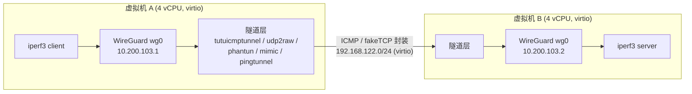
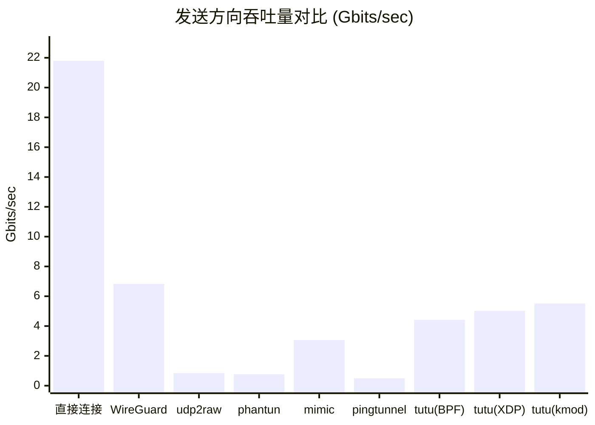
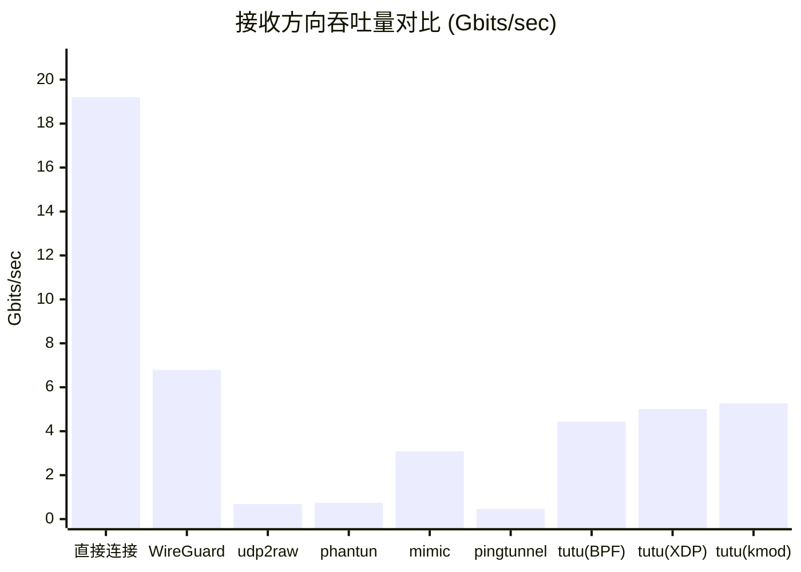

# 性能测试

本文对比 `tutuicmptunnel`（BPF / XDP / kmod 三种实现）与 `udp2raw`、`phantun`、`mimic`、`pingtunnel` 等常见 UDP 伪装方案承载 WireGuard 时的吞吐性能。所有测试均在相同的两台虚拟机之间进行，命令统一为 `iperf3 -t 20`，发送与接收方向各测一次。

## 测试环境

* 宿主机：`Ryzen 7 5700X`，`Arch Linux`（2025-07-10），64G 内存
* 测试机：两台 `Arch Linux` 虚拟机（`libvirt QEMU/KVM`，各 4 vCPU，网卡 `virtio`）
* 测试命令：`iperf3 -s` 与 `iperf3 -c <IP> -t 20`，反向测试加 `-R`
* WireGuard 工作于 IPv4 模式



## 性能测试数据汇总

| 测试场景 | 测试方向 | 平均速率 (Gbits/sec) | 性能损失 (相比直接连接) | 观察到的CPU占用 |
| :--- | :--- | :--- | :--- | :--- |
| **1. 直接连接 (基准)** | 发送 | **21.8** | 0% (基准) | 单核 100% (iperf3 瓶颈) |
| | 接收 | **19.2** | 0% (基准) | 单核 100% (iperf3 瓶颈) |
| **2. WireGuard (纯UDP)** | 发送 | **6.83** | -68.7% | 4核负载均衡 (1核~60%, 其余~40%) |
| | 接收 | **6.79** | -64.6% | 4核负载高且均衡 (~86%) |
| **3. WireGuard + udp2raw** | 发送 | 0.841 | -96.1% | 低负载 (1核~60%, 其余~10-30%) |
| | 接收 | 0.684 | -96.4% | 中负载 (4核~40-50%) |
| **4. WireGuard + phantun** | 发送 | 0.769 | -96.4% | 中负载 (4核~50%) |
| | 接收 | 0.746 | -96.1% | 中负载 (4核~60%) |
| **5. WireGuard + mimic** | 发送 | 3.06 | -86.0% | 高负载 (一核90%，其余3核10~20%) |
| | 接收 | 3.09 | -83.9% | 高负载且均衡 (4核~60-70%) |
| **6. WireGuard + pingtunnel** | 发送 | 0.49 | -97.8% | 中负载 (4核~50%) |
| | 接收 | 0.46 | -97.6% | 中负载 (4核~60%) |
| **7. WireGuard + tutuicmptunnel (BPF)** | 发送 | **4.42** | -79.7% | 高负载 (1核~90-100%, 其余~20-30%) |
| | 接收 | **4.43** | -77.0% | 高负载且均衡 (4核~60-70%) |
| **8. WireGuard + tutuicmptunnel (XDP)** | 发送 | **5.02** | -76.9% | 高负载 (1核~80%, 其余~30-40%) |
| | 接收 | **5.01** | -73.9% | 高负载且均衡 (4核~70%) |
| **9. WireGuard + tutuicmptunnel-kmod** | 发送 | **5.51** | -74.7% | 高负载 (单核80%，其余三核30～40%) |
| | 接收 | **5.27** | -72.6% | 高负载且均衡 (4核~60-70%) |





## 结论

从整体结果看，UDP 伪装层的开销差异极大，大致可分为三档：

**第一档是 `tutuicmptunnel` 系列。** BPF 版本收发均在 4.4 Gbps 左右，达到纯 WireGuard 直连的约 65%；开启 XDP ingress 后提升到约 5 Gbps；内核模块（kmod）版本最快，收发分别达到 5.51 和 5.27 Gbps，约为 BPF 版的 1.2 倍——`nftables` 内核路径确实比 BPF 更短。三者都已逼近纯 WireGuard 的性能，说明瓶颈主要在 WireGuard 本身而非伪装层。

**第二档是 `mimic`。** 作为同样基于 BPF 的 fakeTCP 工具，它能跑到约 3 Gbps，但只相当于 `tutuicmptunnel`（BPF）的 70% 左右，且发送方向单核打满，扩展性一般。

**第三档是 `udp2raw`、`phantun` 和 `pingtunnel`，均在 1 Gbps 以下。** 三者中 `pingtunnel` 最慢（收发不足 0.5 Gbps），`tutuicmptunnel` 比它快约 9 倍；`udp2raw` 与 `phantun` 互有胜负，`tutuicmptunnel` 比它们快 5~6 倍。值得注意的是 `udp2raw` 波动剧烈，测试中一度跌到 280 Mbps，推测是用户态进程调度抖动所致，多核设计的 `phantun` 相对稳定一些，而 `tutuicmptunnel` 全程没有出现类似抖动。

---

## 详细配置与原始数据

以下保留各场景的完整配置与 `iperf3` 原始输出，供查证，默认折叠。

<details>
<summary><strong>`iperf3` 直接连接（基准）</strong></summary>

`mtu`: 1500

```
❯ iperf3 -c peer -t 20
Connecting to host peer, port 5201
[  5] local 192.168.122.187 port 36372 connected to 192.168.122.58 port 5201
[ ID] Interval           Transfer     Bitrate         Retr  Cwnd
[  5]   0.00-1.00   sec  2.72 GBytes  23.4 Gbits/sec    0   3.61 MBytes       
[  5]   1.00-2.00   sec  2.36 GBytes  20.3 Gbits/sec    0   3.82 MBytes       
[  5]   2.00-3.00   sec  2.14 GBytes  18.4 Gbits/sec    0   3.82 MBytes       
[  5]   3.00-4.00   sec  2.19 GBytes  18.8 Gbits/sec    0   3.82 MBytes       
[  5]   4.00-5.00   sec  2.62 GBytes  22.5 Gbits/sec    0   3.82 MBytes       
[  5]   5.00-6.00   sec  2.49 GBytes  21.4 Gbits/sec    0   3.82 MBytes       
[  5]   6.00-7.00   sec  2.37 GBytes  20.3 Gbits/sec    0   3.82 MBytes       
[  5]   7.00-8.00   sec  2.51 GBytes  21.6 Gbits/sec    0   3.82 MBytes       
[  5]   8.00-9.00   sec  2.40 GBytes  20.7 Gbits/sec    0   3.82 MBytes       
[  5]   9.00-10.00  sec  2.44 GBytes  21.0 Gbits/sec    0   3.82 MBytes       
[  5]  10.00-11.00  sec  2.54 GBytes  21.8 Gbits/sec    0   3.82 MBytes       
[  5]  11.00-12.00  sec  2.58 GBytes  22.2 Gbits/sec    0   3.82 MBytes       
[  5]  12.00-13.00  sec  2.51 GBytes  21.6 Gbits/sec    0   3.82 MBytes       
[  5]  13.00-14.00  sec  2.42 GBytes  20.7 Gbits/sec    0   3.82 MBytes       
[  5]  14.00-15.00  sec  2.51 GBytes  21.5 Gbits/sec    0   3.82 MBytes       
[  5]  15.00-16.00  sec  2.54 GBytes  21.8 Gbits/sec    0   3.82 MBytes       
[  5]  16.00-17.00  sec  2.50 GBytes  21.5 Gbits/sec    0   3.82 MBytes       
[  5]  17.00-18.00  sec  2.57 GBytes  22.1 Gbits/sec    0   3.82 MBytes       
[  5]  18.00-19.00  sec  2.53 GBytes  21.8 Gbits/sec    0   3.82 MBytes       
[  5]  19.00-20.00  sec  2.49 GBytes  21.4 Gbits/sec    0   3.82 MBytes       
- - - - - - - - - - - - - - - - - - - - - - - - -
[ ID] Interval           Transfer     Bitrate         Retr
[  5]   0.00-20.00  sec  50.8 GBytes  21.8 Gbits/sec    0            sender
[  5]   0.00-20.00  sec  50.8 GBytes  21.8 Gbits/sec                  receiver

iperf Done.

cpu占用率：单核100%

hrimfaxi in 🌐 archlinux2 in ~ took 20s 
❯ iperf3 -c peer -t 20 -R
Connecting to host peer, port 5201
Reverse mode, remote host peer is sending
[  5] local 192.168.122.187 port 57064 connected to 192.168.122.58 port 5201
[ ID] Interval           Transfer     Bitrate
[  5]   0.00-1.00   sec  2.25 GBytes  19.3 Gbits/sec                  
[  5]   1.00-2.00   sec  2.29 GBytes  19.6 Gbits/sec                  
[  5]   2.00-3.00   sec  2.30 GBytes  19.7 Gbits/sec                  
[  5]   3.00-4.00   sec  2.29 GBytes  19.7 Gbits/sec                  
[  5]   4.00-5.00   sec  2.21 GBytes  19.0 Gbits/sec                  
[  5]   5.00-6.00   sec  2.22 GBytes  19.1 Gbits/sec                  
[  5]   6.00-7.00   sec  2.23 GBytes  19.1 Gbits/sec                  
[  5]   7.00-8.00   sec  2.28 GBytes  19.6 Gbits/sec                  
[  5]   8.00-9.00   sec  2.15 GBytes  18.5 Gbits/sec                  
[  5]   9.00-10.00  sec  2.21 GBytes  19.0 Gbits/sec                  
[  5]  10.00-11.00  sec  2.18 GBytes  18.7 Gbits/sec                  
[  5]  11.00-12.00  sec  2.22 GBytes  19.1 Gbits/sec                  
[  5]  12.00-13.00  sec  2.20 GBytes  18.9 Gbits/sec                  
[  5]  13.00-14.00  sec  2.13 GBytes  18.3 Gbits/sec                  
[  5]  14.00-15.00  sec  2.19 GBytes  18.8 Gbits/sec                  
[  5]  15.00-16.00  sec  2.27 GBytes  19.5 Gbits/sec                  
[  5]  16.00-17.00  sec  2.31 GBytes  19.8 Gbits/sec                  
[  5]  17.00-18.00  sec  2.27 GBytes  19.5 Gbits/sec                  
[  5]  18.00-19.00  sec  2.26 GBytes  19.4 Gbits/sec                  
[  5]  19.00-20.00  sec  2.27 GBytes  19.5 Gbits/sec                  
- - - - - - - - - - - - - - - - - - - - - - - - -
[ ID] Interval           Transfer     Bitrate         Retr
[  5]   0.00-20.00  sec  44.7 GBytes  19.2 Gbits/sec    0            sender
[  5]   0.00-20.00  sec  44.7 GBytes  19.2 Gbits/sec                  receiver

iperf Done.

cpu占用率：单核100%
```

</details>

<details>
<summary><strong>`wireguard`（纯 UDP）</strong></summary>

`MTU`: 1420

`iperf3`测速

```sh
[root@archlinux2 wireguard]# iperf3 -c peer-wg -t 20
Connecting to host peer-wg, port 5201
[  5] local 10.200.103.2 port 35884 connected to 10.200.103.1 port 5201
[ ID] Interval           Transfer     Bitrate         Retr  Cwnd
[  5]   0.00-1.00   sec   791 MBytes  6.63 Gbits/sec  254   1.25 MBytes       
[  5]   1.00-2.00   sec   778 MBytes  6.53 Gbits/sec    6   1.20 MBytes       
[  5]   2.00-3.00   sec   814 MBytes  6.82 Gbits/sec    9   1.20 MBytes       
[  5]   3.00-4.00   sec   789 MBytes  6.62 Gbits/sec   15   1.17 MBytes       
[  5]   4.00-5.00   sec   839 MBytes  7.04 Gbits/sec    3   1.06 MBytes       
[  5]   5.00-6.00   sec   828 MBytes  6.95 Gbits/sec   15    998 KBytes       
[  5]   6.00-7.00   sec   851 MBytes  7.13 Gbits/sec    0   1.33 MBytes       
[  5]   7.00-8.00   sec   824 MBytes  6.91 Gbits/sec    9   1.33 MBytes       
[  5]   8.00-9.00   sec   812 MBytes  6.81 Gbits/sec   33   1.29 MBytes       
[  5]   9.00-10.00  sec   858 MBytes  7.20 Gbits/sec    7   1.26 MBytes       
[  5]  10.00-11.00  sec   830 MBytes  6.96 Gbits/sec    5   1.22 MBytes       
[  5]  11.00-12.00  sec   791 MBytes  6.63 Gbits/sec   27   1.14 MBytes       
[  5]  12.00-13.00  sec   800 MBytes  6.71 Gbits/sec   39   1.02 MBytes       
[  5]  13.00-14.00  sec   838 MBytes  7.03 Gbits/sec   10    994 KBytes       
[  5]  14.00-15.00  sec   808 MBytes  6.77 Gbits/sec    0   1.33 MBytes       
[  5]  15.00-16.00  sec   787 MBytes  6.60 Gbits/sec    1   1.30 MBytes       
[  5]  16.00-17.00  sec   822 MBytes  6.89 Gbits/sec    6   1.30 MBytes       
[  5]  17.00-18.00  sec   806 MBytes  6.76 Gbits/sec    4   1.29 MBytes       
[  5]  18.00-19.00  sec   826 MBytes  6.93 Gbits/sec   10   1.29 MBytes       
[  5]  19.00-20.00  sec   806 MBytes  6.76 Gbits/sec    5   1.25 MBytes       
- - - - - - - - - - - - - - - - - - - - - - - - -
[ ID] Interval           Transfer     Bitrate         Retr
[  5]   0.00-20.00  sec  15.9 GBytes  6.83 Gbits/sec  458            sender
[  5]   0.00-20.00  sec  15.9 GBytes  6.83 Gbits/sec                  receiver

cpu占用率：3个核大约40%, 1个核大约60%

iperf Done.
[root@archlinux2 wireguard]# iperf3 -c peer-wg -t 20 -R
Connecting to host peer-wg, port 5201
Reverse mode, remote host peer-wg is sending
[  5] local 10.200.103.2 port 45884 connected to 10.200.103.1 port 5201
[ ID] Interval           Transfer     Bitrate
[  5]   0.00-1.00   sec   798 MBytes  6.69 Gbits/sec                  
[  5]   1.00-2.00   sec   816 MBytes  6.83 Gbits/sec                  
[  5]   2.00-3.00   sec   805 MBytes  6.76 Gbits/sec                  
[  5]   3.00-4.00   sec   794 MBytes  6.66 Gbits/sec                  
[  5]   4.00-5.00   sec   811 MBytes  6.81 Gbits/sec                  
[  5]   5.00-6.00   sec   789 MBytes  6.62 Gbits/sec                  
[  5]   6.00-7.00   sec   826 MBytes  6.93 Gbits/sec                  
[  5]   7.00-8.00   sec   816 MBytes  6.85 Gbits/sec                  
[  5]   8.00-9.00   sec   825 MBytes  6.92 Gbits/sec                  
[  5]   9.00-10.00  sec   804 MBytes  6.74 Gbits/sec                  
[  5]  10.00-11.00  sec   796 MBytes  6.69 Gbits/sec                  
[  5]  11.00-12.00  sec   821 MBytes  6.89 Gbits/sec                  
[  5]  12.00-13.00  sec   823 MBytes  6.90 Gbits/sec                  
[  5]  13.00-14.00  sec   803 MBytes  6.74 Gbits/sec                  
[  5]  14.00-15.00  sec   784 MBytes  6.58 Gbits/sec                  
[  5]  15.00-16.00  sec   794 MBytes  6.66 Gbits/sec                  
[  5]  16.00-17.00  sec   828 MBytes  6.95 Gbits/sec                  
[  5]  17.00-18.00  sec   826 MBytes  6.93 Gbits/sec                  
[  5]  18.00-19.00  sec   831 MBytes  6.97 Gbits/sec                  
[  5]  19.00-20.00  sec   803 MBytes  6.73 Gbits/sec                  
- - - - - - - - - - - - - - - - - - - - - - - - -
[ ID] Interval           Transfer     Bitrate         Retr
[  5]   0.00-20.00  sec  15.8 GBytes  6.79 Gbits/sec  546            sender
[  5]   0.00-20.00  sec  15.8 GBytes  6.79 Gbits/sec                  receiver

iperf Done.

cpu占用率：4核大约86%
```

</details>

<details>
<summary><strong>`wireguard` + `udp2raw`</strong></summary>

udp2raw 命令：

```sh
# 服务器A
sudo udp2raw -s \
    --raw-mode icmp \
    -l 0.0.0.0:1234 \
    -r 127.0.0.1:51820 \
    -a \
    --cipher-mode none \
    --auth-mode none \
    --fix-gro
# 服务器B
sudo udp2raw -c \
    --raw-mode icmp \
    -l 127.0.0.1:1234 \
    -r 192.168.122.58:51820 \
    -a \
    --cipher-mode none \
    --auth-mode none \
    --fix-gro
```

`MTU`: 1342
`wireguard` 需要将 `endpoint` 修改为 `127.0.0.1:1234`。

```sh
❯ iperf3 -c peer-wg -t 20
Connecting to host peer-wg, port 5201
[  5] local 10.200.103.1 port 32954 connected to 10.200.103.2 port 5201
[ ID] Interval           Transfer     Bitrate         Retr  Cwnd
[  5]   0.00-1.00   sec  91.1 MBytes   764 Mbits/sec   28    174 KBytes       
[  5]   1.00-2.00   sec  89.2 MBytes   749 Mbits/sec   39    207 KBytes       
[  5]   2.00-3.00   sec   105 MBytes   880 Mbits/sec   41    243 KBytes       
[  5]   3.00-4.00   sec  91.5 MBytes   768 Mbits/sec   27    160 KBytes       
[  5]   4.00-5.00   sec   109 MBytes   912 Mbits/sec   53    149 KBytes       
[  5]   5.00-6.00   sec   106 MBytes   887 Mbits/sec   82    202 KBytes       
[  5]   6.00-7.00   sec   106 MBytes   886 Mbits/sec   33    195 KBytes       
[  5]   7.00-8.00   sec  98.0 MBytes   823 Mbits/sec   75    215 KBytes       
[  5]   8.00-9.00   sec  97.5 MBytes   818 Mbits/sec   43    191 KBytes       
[  5]   9.00-10.00  sec  93.5 MBytes   784 Mbits/sec   47    175 KBytes       
[  5]  10.00-11.00  sec   113 MBytes   945 Mbits/sec   66    186 KBytes       
[  5]  11.00-12.00  sec   103 MBytes   866 Mbits/sec   27    142 KBytes       
[  5]  12.00-13.00  sec  98.0 MBytes   822 Mbits/sec    9    207 KBytes       
[  5]  13.00-14.00  sec  97.8 MBytes   820 Mbits/sec   58    171 KBytes       
[  5]  14.00-15.00  sec  93.5 MBytes   784 Mbits/sec   59    205 KBytes       
[  5]  15.00-16.00  sec   102 MBytes   853 Mbits/sec   63    179 KBytes       
[  5]  16.00-17.00  sec  97.6 MBytes   819 Mbits/sec   61    156 KBytes       
[  5]  17.00-18.00  sec   109 MBytes   911 Mbits/sec   32    189 KBytes       
[  5]  18.00-19.00  sec  99.2 MBytes   832 Mbits/sec   30    205 KBytes       
[  5]  19.00-20.00  sec   107 MBytes   900 Mbits/sec   47    205 KBytes       
- - - - - - - - - - - - - - - - - - - - - - - - -
[ ID] Interval           Transfer     Bitrate         Retr
[  5]   0.00-20.00  sec  1.96 GBytes   841 Mbits/sec  920            sender
[  5]   0.00-20.00  sec  1.96 GBytes   840 Mbits/sec                  receiver

iperf Done.

cpu占用率：3个核大约10~30%, 1个核大约60%


❯ iperf3 -c peer-wg -t 20  -R
Connecting to host peer-wg, port 5201
Reverse mode, remote host peer-wg is sending
[  5] local 10.200.103.1 port 51958 connected to 10.200.103.2 port 5201
[ ID] Interval           Transfer     Bitrate
[  5]   0.00-1.00   sec  86.1 MBytes   722 Mbits/sec                  
[  5]   1.00-2.00   sec   103 MBytes   866 Mbits/sec                  
[  5]   2.00-3.00   sec  97.4 MBytes   817 Mbits/sec                  
[  5]   3.00-4.00   sec  87.6 MBytes   735 Mbits/sec                  
[  5]   4.00-5.00   sec  91.0 MBytes   763 Mbits/sec                  
[  5]   5.00-6.00   sec  94.9 MBytes   795 Mbits/sec                  
[  5]   6.00-7.00   sec  97.8 MBytes   821 Mbits/sec                  
[  5]   7.00-8.00   sec  87.5 MBytes   734 Mbits/sec                  
[  5]   8.00-9.00   sec  83.2 MBytes   698 Mbits/sec                  
[  5]   9.00-10.00  sec  80.6 MBytes   677 Mbits/sec                  
[  5]  10.00-11.00  sec  81.2 MBytes   681 Mbits/sec                  
[  5]  11.00-12.00  sec  84.5 MBytes   709 Mbits/sec                  
[  5]  12.00-13.00  sec  81.8 MBytes   685 Mbits/sec                  
[  5]  13.00-14.00  sec  69.1 MBytes   580 Mbits/sec                  
[  5]  14.00-15.00  sec  66.8 MBytes   560 Mbits/sec                  
[  5]  15.00-16.00  sec  67.0 MBytes   562 Mbits/sec                  
[  5]  16.00-17.00  sec  67.0 MBytes   562 Mbits/sec                  
[  5]  17.00-18.00  sec  65.6 MBytes   550 Mbits/sec                  
[  5]  18.00-19.00  sec  65.2 MBytes   547 Mbits/sec                  
[  5]  19.00-20.00  sec  73.6 MBytes   617 Mbits/sec                  
- - - - - - - - - - - - - - - - - - - - - - - - -
[ ID] Interval           Transfer     Bitrate         Retr
[  5]   0.00-20.00  sec  1.59 GBytes   684 Mbits/sec  676            sender
[  5]   0.00-20.00  sec  1.59 GBytes   684 Mbits/sec                  receiver

iperf Done.

cpu占用率：4个核大约40~50%
```

</details>

<details>
<summary><strong>`wireguard` + `phantun`</strong></summary>

```
服务器：
sysctl net.ipv4.ip_forward=1
iptables -t nat -A PREROUTING -p tcp -i enp1s0 --dport 4567 -j DNAT --to-destination 192.168.201.2
RUST_LOG=info /usr/local/bin/phantun_server --local 4567 --remote 127.0.0.1:1234

wg0.conf:
ListenPort = 1234

客户端:
sysctl net.ipv4.ip_forward=1
iptables -t nat -A POSTROUTING -o enp1s0 -j MASQUERADE
RUST_LOG=info /usr/local/bin/phantun_client --local 127.0.0.1:1234 --remote peer:4567

wg0.conf:
Endpoint = 127.0.0.1:1234 # phantun
```

iperf3 测速结果：

```
❯ iperf3 -c peer-wg -t 20
Connecting to host peer-wg, port 5201
[  5] local 10.200.103.1 port 50874 connected to 10.200.103.2 port 5201
[ ID] Interval           Transfer     Bitrate         Retr  Cwnd
[  5]   0.00-1.00   sec  89.6 MBytes   752 Mbits/sec  101   90.7 KBytes
[  5]   1.00-2.00   sec  92.4 MBytes   774 Mbits/sec   81    102 KBytes
[  5]   2.00-3.00   sec  93.4 MBytes   784 Mbits/sec  127   88.2 KBytes
[  5]   3.00-4.00   sec  89.8 MBytes   753 Mbits/sec  106    110 KBytes
[  5]   4.00-5.00   sec  93.8 MBytes   786 Mbits/sec  131   76.8 KBytes
[  5]   5.00-6.00   sec  92.0 MBytes   773 Mbits/sec   97   79.4 KBytes
[  5]   6.00-7.00   sec  96.6 MBytes   810 Mbits/sec  133    103 KBytes
[  5]   7.00-8.00   sec  92.5 MBytes   776 Mbits/sec  114   76.8 KBytes
[  5]   8.00-9.00   sec  92.9 MBytes   779 Mbits/sec  113   83.1 KBytes
[  5]   9.00-10.00  sec  93.2 MBytes   782 Mbits/sec  109   61.7 KBytes
[  5]  10.00-11.00  sec  96.2 MBytes   807 Mbits/sec   72   92.0 KBytes
[  5]  11.00-12.00  sec  93.9 MBytes   787 Mbits/sec   96    103 KBytes
[  5]  12.00-13.00  sec  91.4 MBytes   767 Mbits/sec   84    105 KBytes
[  5]  13.00-14.00  sec  92.8 MBytes   779 Mbits/sec  133   92.0 KBytes
[  5]  14.00-15.00  sec  92.6 MBytes   776 Mbits/sec  119   80.6 KBytes
[  5]  15.00-16.00  sec  94.5 MBytes   794 Mbits/sec   90   89.4 KBytes
[  5]  16.00-17.00  sec  95.0 MBytes   797 Mbits/sec   70   76.8 KBytes
[  5]  17.00-18.00  sec  83.6 MBytes   701 Mbits/sec  110   83.1 KBytes
[  5]  18.00-19.00  sec  79.5 MBytes   667 Mbits/sec  108   86.9 KBytes
[  5]  19.00-20.00  sec  88.0 MBytes   739 Mbits/sec   90   81.9 KBytes
- - - - - - - - - - - - - - - - - - - - - - - - -
[ ID] Interval           Transfer     Bitrate         Retr
[  5]   0.00-20.00  sec  1.79 GBytes   769 Mbits/sec  2084            sender
[  5]   0.00-20.00  sec  1.79 GBytes   769 Mbits/sec                  receiver

iperf Done.

cpu占用率： 4核50%左右

❯ iperf3 -c peer-wg -t 20 -R
Connecting to host peer-wg, port 5201
Reverse mode, remote host peer-wg is sending
[  5] local 10.200.103.1 port 39950 connected to 10.200.103.2 port 5201
[ ID] Interval           Transfer     Bitrate
[  5]   0.00-1.00   sec  88.6 MBytes   743 Mbits/sec                  
[  5]   1.00-2.00   sec  85.9 MBytes   721 Mbits/sec                  
[  5]   2.00-3.00   sec  94.2 MBytes   791 Mbits/sec                  
[  5]   3.00-4.00   sec  91.9 MBytes   771 Mbits/sec                  
[  5]   4.00-5.00   sec  91.4 MBytes   767 Mbits/sec                  
[  5]   5.00-6.00   sec  92.1 MBytes   772 Mbits/sec                  
[  5]   6.00-7.00   sec  93.5 MBytes   785 Mbits/sec                  
[  5]   7.00-8.00   sec  71.5 MBytes   599 Mbits/sec                  
[  5]   8.00-9.00   sec  88.9 MBytes   746 Mbits/sec                  
[  5]   9.00-10.00  sec  90.2 MBytes   757 Mbits/sec                  
[  5]  10.00-11.00  sec  90.2 MBytes   757 Mbits/sec                  
[  5]  11.00-12.00  sec  71.8 MBytes   602 Mbits/sec                  
[  5]  12.00-13.00  sec  93.4 MBytes   783 Mbits/sec                  
[  5]  13.00-14.00  sec  90.5 MBytes   759 Mbits/sec                  
[  5]  14.00-15.00  sec  92.6 MBytes   777 Mbits/sec                  
[  5]  15.00-16.00  sec  93.2 MBytes   782 Mbits/sec                  
[  5]  16.00-17.00  sec  89.8 MBytes   753 Mbits/sec                  
[  5]  17.00-18.00  sec  91.5 MBytes   768 Mbits/sec                  
[  5]  18.00-19.00  sec  90.4 MBytes   758 Mbits/sec                  
[  5]  19.00-20.00  sec  86.0 MBytes   722 Mbits/sec                  
- - - - - - - - - - - - - - - - - - - - - - - - -
[ ID] Interval           Transfer     Bitrate         Retr
[  5]   0.00-20.00  sec  1.74 GBytes   746 Mbits/sec  2127            sender
[  5]   0.00-20.00  sec  1.74 GBytes   746 Mbits/sec                  receiver

iperf Done.

cpu占用率： 4核60%左右
```

</details>

<details>
<summary><strong>`wireguard` + `mimic`</strong></summary>

> 服务器配置

```ini
log.verbosity = error
link_type = eth
xdp_mode = native
#use_libxdp = false
max_window = false
filter = local=192.168.122.58:51820
```

> 客户端配置

```ini
log.verbosity = 0
link_type = eth
xdp_mode = native
#use_libxdp = false
max_window = false
filter = remote=192.168.122.58:51820
```

> iperf3

```
❯ iperf3 -c peer-wg -t 20 
Connecting to host peer-wg, port 5201
[  5] local 10.200.103.1 port 52090 connected to 10.200.103.2 port 5201
[ ID] Interval           Transfer     Bitrate         Retr  Cwnd
[  5]   0.00-1.00   sec   369 MBytes  3.09 Gbits/sec  391   1.43 MBytes       
[  5]   1.00-2.00   sec   381 MBytes  3.19 Gbits/sec    0   1.57 MBytes       
[  5]   2.00-3.00   sec   373 MBytes  3.13 Gbits/sec  138   1.22 MBytes       
[  5]   3.00-4.00   sec   376 MBytes  3.16 Gbits/sec    0   1.38 MBytes       
[  5]   4.00-5.00   sec   363 MBytes  3.04 Gbits/sec   19   1.14 MBytes       
[  5]   5.00-6.00   sec   373 MBytes  3.13 Gbits/sec    0   1.30 MBytes       
[  5]   6.00-7.00   sec   376 MBytes  3.15 Gbits/sec    0   1.42 MBytes       
[  5]   7.00-8.00   sec   399 MBytes  3.35 Gbits/sec   52   1.11 MBytes       
[  5]   8.00-9.00   sec   356 MBytes  2.98 Gbits/sec    0   1.23 MBytes       
[  5]   9.00-10.00  sec   362 MBytes  3.04 Gbits/sec    0   1.36 MBytes       
[  5]  10.00-11.00  sec   356 MBytes  2.99 Gbits/sec   48   1.11 MBytes       
[  5]  11.00-12.00  sec   376 MBytes  3.16 Gbits/sec    0   1.28 MBytes       
[  5]  12.00-13.00  sec   348 MBytes  2.92 Gbits/sec    0   1.41 MBytes       
[  5]  13.00-14.00  sec   347 MBytes  2.91 Gbits/sec   44   1.10 MBytes       
[  5]  14.00-15.00  sec   367 MBytes  3.08 Gbits/sec    0   1.27 MBytes       
[  5]  15.00-16.00  sec   335 MBytes  2.81 Gbits/sec    0   1.37 MBytes       
[  5]  16.00-17.00  sec   365 MBytes  3.06 Gbits/sec    0   1.50 MBytes       
[  5]  17.00-18.00  sec   346 MBytes  2.91 Gbits/sec   86   1.16 MBytes       
[  5]  18.00-19.00  sec   347 MBytes  2.91 Gbits/sec    0   1.30 MBytes       
[  5]  19.00-20.00  sec   371 MBytes  3.11 Gbits/sec    0   1.44 MBytes       
- - - - - - - - - - - - - - - - - - - - - - - - -
[ ID] Interval           Transfer     Bitrate         Retr
[  5]   0.00-20.00  sec  7.12 GBytes  3.06 Gbits/sec  778            sender
[  5]   0.00-20.00  sec  7.11 GBytes  3.05 Gbits/sec                  receiver

iperf Done.

CPU占用率： 一核90%，其余3核10~20%

❯ iperf3 -c peer-wg -t 20 -R
Connecting to host peer-wg, port 5201
Reverse mode, remote host peer-wg is sending
[  5] local 10.200.103.1 port 59982 connected to 10.200.103.2 port 5201
[ ID] Interval           Transfer     Bitrate
[  5]   0.00-1.00   sec   368 MBytes  3.08 Gbits/sec                  
[  5]   1.00-2.00   sec   360 MBytes  3.02 Gbits/sec                  
[  5]   2.00-3.00   sec   348 MBytes  2.92 Gbits/sec                  
[  5]   3.00-4.00   sec   333 MBytes  2.79 Gbits/sec                  
[  5]   4.00-5.00   sec   365 MBytes  3.07 Gbits/sec                  
[  5]   5.00-6.00   sec   373 MBytes  3.13 Gbits/sec                  
[  5]   6.00-7.00   sec   375 MBytes  3.15 Gbits/sec                  
[  5]   7.00-8.00   sec   382 MBytes  3.20 Gbits/sec                  
[  5]   8.00-9.00   sec   384 MBytes  3.22 Gbits/sec                  
[  5]   9.00-10.00  sec   377 MBytes  3.16 Gbits/sec                  
[  5]  10.00-11.00  sec   379 MBytes  3.18 Gbits/sec                  
[  5]  11.00-12.00  sec   378 MBytes  3.17 Gbits/sec                  
[  5]  12.00-13.00  sec   382 MBytes  3.20 Gbits/sec                  
[  5]  13.00-14.00  sec   350 MBytes  2.93 Gbits/sec                  
[  5]  14.00-15.00  sec   372 MBytes  3.12 Gbits/sec                  
[  5]  15.00-16.00  sec   367 MBytes  3.08 Gbits/sec                  
[  5]  16.00-17.00  sec   372 MBytes  3.12 Gbits/sec                  
[  5]  17.00-18.00  sec   379 MBytes  3.17 Gbits/sec                  
[  5]  18.00-19.00  sec   354 MBytes  2.97 Gbits/sec                  
[  5]  19.00-20.00  sec   360 MBytes  3.02 Gbits/sec                  
- - - - - - - - - - - - - - - - - - - - - - - - -
[ ID] Interval           Transfer     Bitrate         Retr
[  5]   0.00-20.00  sec  7.19 GBytes  3.09 Gbits/sec  153            sender
[  5]   0.00-20.00  sec  7.18 GBytes  3.08 Gbits/sec                  receiver

iperf Done.

CPU占用率： 4核60~70%
```

</details>

<details>
<summary><strong>`wireguard` + `pingtunnel`</strong></summary>

基于原始套接字的 ICMP 转发隧道，支持转发 `udp` / `tcp` / `socks5`。

```
服务器：
sudo tee /proc/sys/net/ipv4/icmp_echo_ignore_all <<< 1
sudo pingtunnel -type server

客户端：
sudo tee /proc/sys/net/ipv4/icmp_echo_ignore_all <<< 1
# 开启udp转发到服务器的wireguard端口51820
sudo pingtunnel -type client -l :4455  -s 192.168.122.58 -t 127.0.0.1:51820
```

iperf3 测速结果：

```
❯ iperf3 -c peer-wg -t 20  
Connecting to host peer-wg, port 5201
[  5] local 10.200.103.2 port 46090 connected to 10.200.103.1 port 5201
[ ID] Interval           Transfer     Bitrate         Retr  Cwnd
[  5]   0.00-1.00   sec  57.4 MBytes   481 Mbits/sec   53    103 KBytes       
[  5]   1.00-2.00   sec  59.6 MBytes   501 Mbits/sec   47    102 KBytes       
[  5]   2.00-3.00   sec  55.4 MBytes   465 Mbits/sec   52    100 KBytes       
[  5]   3.00-4.00   sec  65.2 MBytes   547 Mbits/sec   68    111 KBytes       
[  5]   4.00-5.00   sec  64.1 MBytes   538 Mbits/sec   84    102 KBytes       
[  5]   5.00-6.00   sec  58.8 MBytes   492 Mbits/sec   55    112 KBytes       
[  5]   6.00-7.00   sec  57.1 MBytes   479 Mbits/sec   63   81.5 KBytes       
[  5]   7.00-8.00   sec  58.8 MBytes   493 Mbits/sec   52    111 KBytes       
[  5]   8.00-9.00   sec  60.9 MBytes   511 Mbits/sec   62   86.8 KBytes       
[  5]   9.00-10.00  sec  57.5 MBytes   482 Mbits/sec   51   97.5 KBytes       
[  5]  10.00-11.00  sec  57.2 MBytes   480 Mbits/sec   55   85.5 KBytes       
[  5]  11.00-12.00  sec  57.2 MBytes   480 Mbits/sec   49    107 KBytes       
[  5]  12.00-13.00  sec  60.5 MBytes   508 Mbits/sec   69   89.5 KBytes       
[  5]  13.00-14.00  sec  56.8 MBytes   476 Mbits/sec   58   78.8 KBytes       
[  5]  14.00-15.00  sec  57.8 MBytes   484 Mbits/sec   43    112 KBytes       
[  5]  15.00-16.00  sec  57.4 MBytes   481 Mbits/sec   64   92.2 KBytes       
[  5]  16.00-17.00  sec  55.6 MBytes   467 Mbits/sec   69   86.8 KBytes       
[  5]  17.00-18.00  sec  58.6 MBytes   491 Mbits/sec   78   76.1 KBytes       
[  5]  18.00-19.00  sec  62.6 MBytes   526 Mbits/sec   69   97.5 KBytes       
[  5]  19.00-20.00  sec  61.4 MBytes   515 Mbits/sec   46    104 KBytes       
- - - - - - - - - - - - - - - - - - - - - - - - -
[ ID] Interval           Transfer     Bitrate         Retr
[  5]   0.00-20.00  sec  1.15 GBytes   495 Mbits/sec  1187            sender
[  5]   0.00-19.99  sec  1.15 GBytes   495 Mbits/sec                  receiver

cpu占用率: 4核40%左右。

❯ iperf3 -c peer-wg -t 20  -R
Connecting to host peer-wg, port 5201
Reverse mode, remote host peer-wg is sending
[  5] local 10.200.103.2 port 34400 connected to 10.200.103.1 port 5201
[ ID] Interval           Transfer     Bitrate
[  5]   0.00-1.00   sec  53.4 MBytes   448 Mbits/sec                  
[  5]   1.00-2.00   sec  47.0 MBytes   394 Mbits/sec                  
[  5]   2.00-3.00   sec  54.5 MBytes   457 Mbits/sec                  
[  5]   3.00-4.00   sec  53.8 MBytes   451 Mbits/sec                  
[  5]   4.00-5.00   sec  54.6 MBytes   458 Mbits/sec                  
[  5]   5.00-6.00   sec  52.4 MBytes   439 Mbits/sec                  
[  5]   6.00-7.00   sec  49.8 MBytes   418 Mbits/sec                  
[  5]   7.00-8.00   sec  56.8 MBytes   476 Mbits/sec                  
[  5]   8.00-9.00   sec  58.0 MBytes   487 Mbits/sec                  
[  5]   9.00-10.00  sec  55.8 MBytes   468 Mbits/sec                  
[  5]  10.00-11.00  sec  52.0 MBytes   436 Mbits/sec                  
[  5]  11.00-12.00  sec  50.9 MBytes   427 Mbits/sec                  
[  5]  12.00-13.00  sec  55.8 MBytes   468 Mbits/sec                  
[  5]  13.00-14.00  sec  55.1 MBytes   462 Mbits/sec                  
[  5]  14.00-15.00  sec  55.1 MBytes   463 Mbits/sec                  
[  5]  15.00-16.00  sec  58.5 MBytes   491 Mbits/sec                  
[  5]  16.00-17.00  sec  58.1 MBytes   488 Mbits/sec                  
[  5]  17.00-18.00  sec  56.5 MBytes   474 Mbits/sec                  
[  5]  18.00-19.00  sec  58.4 MBytes   490 Mbits/sec                  
[  5]  19.00-20.00  sec  56.5 MBytes   474 Mbits/sec                  
- - - - - - - - - - - - - - - - - - - - - - - - -
[ ID] Interval           Transfer     Bitrate         Retr
[  5]   0.00-19.99  sec  1.07 GBytes   460 Mbits/sec  951            sender
[  5]   0.00-20.00  sec  1.07 GBytes   458 Mbits/sec                  receiver

iperf Done.

cpu占用率: 4核50%左右。
```

</details>

<details>
<summary><strong>`wireguard` + `tutuicmptunnel`</strong></summary>

* `tutu_csum_fixup`：未启用 `force_sw_checksum=1`
* `MTU`：与 `wireguard` 相同，1420
* `TUTU_UID`：102

`wg0.conf`添加到`[Interface]`:
```
PreUp = env_file=$(dirname $CONFIG_FILE)/tutuicmptunnel.wg0; source $env_file && tuctl client-add user $TUTU_UID address $ADDR port $PORT comment $COMMENT || true
PreUp = env_file=$(dirname $CONFIG_FILE)/tutuicmptunnel.wg0; source $env_file && IP=192.168.122.187 && tuctl_client server $ADDR server-port $SERVER_PORT psk $PSK <<< "server-add user $TUTU_UID comment $COMMENT address $IP port $PORT" || true
PostDown = env_file=$(dirname $CONFIG_FILE)/tutuicmptunnel.wg0; source $env_file && tuctl client-del user $TUTU_UID address $ADDR || true
PostDown = env_file=$(dirname $CONFIG_FILE)/tutuicmptunnel.wg0; source $env_file && tuctl_client server $ADDR server-port $SERVER_PORT psk $PSK <<< "server-del user $TUTU_UID" || true
```

`/etc/wireguard/tutuicmptunnel.wg0`

```sh

TUTU_UID=vm2
ADDR=peer
PORT=51820
SERVER_PORT=14801
PSK=yourverylongpsk
COMMENT=vm-wireguard
```

iperf3 测速结果：
```
❯ iperf3 -c peer-wg -t 20 
Connecting to host peer-wg, port 5201
[  5] local 10.200.103.1 port 34564 connected to 10.200.103.2 port 5201
[ ID] Interval           Transfer     Bitrate         Retr  Cwnd
[  5]   0.00-1.00   sec   587 MBytes  4.93 Gbits/sec  194   1013 KBytes       
[  5]   1.00-2.00   sec   495 MBytes  4.15 Gbits/sec    0   1.12 MBytes       
[  5]   2.00-3.00   sec   576 MBytes  4.83 Gbits/sec    0   1.26 MBytes       
[  5]   3.00-4.00   sec   592 MBytes  4.97 Gbits/sec    0   1.35 MBytes       
[  5]   4.00-5.00   sec   511 MBytes  4.29 Gbits/sec    8   1.11 MBytes       
[  5]   5.00-6.00   sec   531 MBytes  4.45 Gbits/sec    0   1.24 MBytes       
[  5]   6.00-7.00   sec   457 MBytes  3.84 Gbits/sec    0   1.32 MBytes       
[  5]   7.00-8.00   sec   506 MBytes  4.24 Gbits/sec    4   1.05 MBytes       
[  5]   8.00-9.00   sec   484 MBytes  4.06 Gbits/sec    0   1.18 MBytes       
[  5]   9.00-10.00  sec   451 MBytes  3.78 Gbits/sec    0   1.24 MBytes       
[  5]  10.00-11.00  sec   405 MBytes  3.39 Gbits/sec    0   1.28 MBytes       
[  5]  11.00-12.00  sec   472 MBytes  3.96 Gbits/sec    0   1.35 MBytes       
[  5]  12.00-13.00  sec   570 MBytes  4.78 Gbits/sec   13   1.10 MBytes       
[  5]  13.00-14.00  sec   446 MBytes  3.74 Gbits/sec    0   1.16 MBytes       
[  5]  14.00-15.00  sec   513 MBytes  4.31 Gbits/sec    0   1.23 MBytes       
[  5]  15.00-16.00  sec   548 MBytes  4.60 Gbits/sec    0   1.29 MBytes       
[  5]  16.00-17.00  sec   507 MBytes  4.25 Gbits/sec    9   1001 KBytes       
[  5]  17.00-18.00  sec   488 MBytes  4.09 Gbits/sec    0   1.13 MBytes       
[  5]  18.00-19.00  sec   565 MBytes  4.74 Gbits/sec    0   1.32 MBytes       
[  5]  19.00-20.00  sec   587 MBytes  4.92 Gbits/sec   27   1.11 MBytes       
- - - - - - - - - - - - - - - - - - - - - - - - -
[ ID] Interval           Transfer     Bitrate         Retr
[  5]   0.00-20.00  sec  10.1 GBytes  4.32 Gbits/sec  255            sender
[  5]   0.00-20.00  sec  10.1 GBytes  4.32 Gbits/sec                  receiver

iperf Done.

cpu占用率：3核20～30%，1核90～100%

❯ iperf3 -c peer-wg -t 20 -R
Connecting to host peer-wg, port 5201
Reverse mode, remote host peer-wg is sending
[  5] local 10.200.103.1 port 48710 connected to 10.200.103.2 port 5201
[ ID] Interval           Transfer     Bitrate
[  5]   0.00-1.00   sec   548 MBytes  4.59 Gbits/sec                  
[  5]   1.00-2.00   sec   488 MBytes  4.09 Gbits/sec                  
[  5]   2.00-3.00   sec   600 MBytes  5.03 Gbits/sec                  
[  5]   3.00-4.00   sec   508 MBytes  4.26 Gbits/sec                  
[  5]   4.00-5.00   sec   453 MBytes  3.80 Gbits/sec                  
[  5]   5.00-6.00   sec   492 MBytes  4.13 Gbits/sec                  
[  5]   6.00-7.00   sec   597 MBytes  5.01 Gbits/sec                  
[  5]   7.00-8.00   sec   545 MBytes  4.57 Gbits/sec                  
[  5]   8.00-9.00   sec   518 MBytes  4.35 Gbits/sec                  
[  5]   9.00-10.00  sec   565 MBytes  4.74 Gbits/sec                  
[  5]  10.00-11.00  sec   600 MBytes  5.03 Gbits/sec                  
[  5]  11.00-12.00  sec   582 MBytes  4.88 Gbits/sec                  
[  5]  12.00-13.00  sec   485 MBytes  4.07 Gbits/sec                  
[  5]  13.00-14.00  sec   550 MBytes  4.61 Gbits/sec                  
[  5]  14.00-15.00  sec   526 MBytes  4.42 Gbits/sec                  
[  5]  15.00-16.00  sec   455 MBytes  3.82 Gbits/sec                  
[  5]  16.00-17.00  sec   507 MBytes  4.25 Gbits/sec                  
[  5]  17.00-18.00  sec   426 MBytes  3.57 Gbits/sec                  
[  5]  18.00-19.00  sec   426 MBytes  3.57 Gbits/sec                  
[  5]  19.00-20.00  sec   457 MBytes  3.84 Gbits/sec                  
- - - - - - - - - - - - - - - - - - - - - - - - -
[ ID] Interval           Transfer     Bitrate         Retr
[  5]   0.00-20.00  sec  10.1 GBytes  4.33 Gbits/sec  267            sender
[  5]   0.00-20.00  sec  10.1 GBytes  4.33 Gbits/sec                  receiver

iperf Done.

cpu占用率：4核60～70%
```

</details>

<details>
<summary><strong>`wireguard` + `tutuicmptunnel`（ENABLE_XDP_INGRESS）</strong></summary>

```
hrimfaxi in 🌐 vm in ~ took 20s
❯ iperf3 -c peer-wg -t 20
Connecting to host peer-wg, port 5201
[  5] local 10.200.103.1 port 40176 connected to 10.200.103.2 port 5201
[ ID] Interval           Transfer     Bitrate         Retr  Cwnd
[  5]   0.00-1.00   sec   636 MBytes  5.33 Gbits/sec   47   1.25 MBytes
[  5]   1.00-2.00   sec   613 MBytes  5.14 Gbits/sec    0   1.34 MBytes
[  5]   2.00-3.00   sec   585 MBytes  4.91 Gbits/sec   17   1.04 MBytes
[  5]   3.00-4.00   sec   610 MBytes  5.11 Gbits/sec    0   1.25 MBytes
[  5]   4.00-5.00   sec   579 MBytes  4.86 Gbits/sec    0   1.32 MBytes
[  5]   5.00-6.00   sec   587 MBytes  4.92 Gbits/sec    0   1.36 MBytes
[  5]   6.00-7.00   sec   584 MBytes  4.90 Gbits/sec   13   1.20 MBytes
[  5]   7.00-8.00   sec   607 MBytes  5.09 Gbits/sec    0   1.30 MBytes
[  5]   8.00-9.00   sec   596 MBytes  5.00 Gbits/sec   15   1010 KBytes
[  5]   9.00-10.00  sec   594 MBytes  4.99 Gbits/sec    0   1.23 MBytes
[  5]  10.00-11.00  sec   617 MBytes  5.18 Gbits/sec    0   1.30 MBytes
[  5]  11.00-12.00  sec   620 MBytes  5.20 Gbits/sec    0   1.38 MBytes
[  5]  12.00-13.00  sec   597 MBytes  5.01 Gbits/sec   10   1.12 MBytes
[  5]  13.00-14.00  sec   567 MBytes  4.76 Gbits/sec    0   1.25 MBytes
[  5]  14.00-15.00  sec   640 MBytes  5.36 Gbits/sec    0   1.32 MBytes
[  5]  15.00-16.00  sec   608 MBytes  5.10 Gbits/sec    0   1.39 MBytes
[  5]  16.00-17.00  sec   584 MBytes  4.90 Gbits/sec   17   1.20 MBytes
[  5]  17.00-18.00  sec   592 MBytes  4.97 Gbits/sec    0   1.35 MBytes
[  5]  18.00-19.00  sec   605 MBytes  5.08 Gbits/sec   11   1.16 MBytes
[  5]  19.00-20.00  sec   547 MBytes  4.58 Gbits/sec    0   1.27 MBytes
- - - - - - - - - - - - - - - - - - - - - - - - -
[ ID] Interval           Transfer     Bitrate         Retr
[  5]   0.00-20.00  sec  11.7 GBytes  5.02 Gbits/sec  130            sender
[  5]   0.00-20.00  sec  11.7 GBytes  5.02 Gbits/sec                  receiver

iperf Done.

cpu占用率: 单核80%，其余三核30～40%

hrimfaxi in 🌐 vm in ~ took 20s
❯ iperf3 -c peer-wg -t 20 -R
Connecting to host peer-wg, port 5201
Reverse mode, remote host peer-wg is sending
[  5] local 10.200.103.1 port 46782 connected to 10.200.103.2 port 5201
[ ID] Interval           Transfer     Bitrate
[  5]   0.00-1.00   sec   595 MBytes  4.99 Gbits/sec
[  5]   1.00-2.00   sec   623 MBytes  5.23 Gbits/sec
[  5]   2.00-3.00   sec   581 MBytes  4.87 Gbits/sec
[  5]   3.00-4.00   sec   625 MBytes  5.25 Gbits/sec
[  5]   4.00-5.00   sec   623 MBytes  5.22 Gbits/sec
[  5]   5.00-6.00   sec   590 MBytes  4.95 Gbits/sec
[  5]   6.00-7.00   sec   563 MBytes  4.72 Gbits/sec
[  5]   7.00-8.00   sec   600 MBytes  5.03 Gbits/sec
[  5]   8.00-9.00   sec   604 MBytes  5.07 Gbits/sec
[  5]   9.00-10.00  sec   602 MBytes  5.05 Gbits/sec
[  5]  10.00-11.00  sec   566 MBytes  4.75 Gbits/sec
[  5]  11.00-12.00  sec   584 MBytes  4.90 Gbits/sec
[  5]  12.00-13.00  sec   604 MBytes  5.07 Gbits/sec
[  5]  13.00-14.00  sec   577 MBytes  4.84 Gbits/sec
[  5]  14.00-15.00  sec   640 MBytes  5.37 Gbits/sec
[  5]  15.00-16.00  sec   602 MBytes  5.05 Gbits/sec
[  5]  16.00-17.00  sec   589 MBytes  4.94 Gbits/sec
[  5]  17.00-18.00  sec   570 MBytes  4.78 Gbits/sec
[  5]  18.00-19.00  sec   607 MBytes  5.09 Gbits/sec
[  5]  19.00-20.00  sec   594 MBytes  4.98 Gbits/sec
- - - - - - - - - - - - - - - - - - - - - - - - -
[ ID] Interval           Transfer     Bitrate         Retr
[  5]   0.00-20.00  sec  11.7 GBytes  5.01 Gbits/sec  1094            sender
[  5]   0.00-20.00  sec  11.7 GBytes  5.01 Gbits/sec                  receiver

cpu占用率: 四核70%左右

iperf Done.

```

</details>

<details>
<summary><strong>`wireguard` + `tutuicmptunnel-kmod`</strong></summary>

```
❯ iperf3 -c peer-wg  -t 20
Connecting to host peer-wg, port 5201
[  5] local 10.200.103.2 port 38680 connected to 10.200.103.1 port 5201
[ ID] Interval           Transfer     Bitrate         Retr  Cwnd
[  5]   0.00-1.00   sec   628 MBytes  5.27 Gbits/sec  297   1.12 MBytes
[  5]   1.00-2.00   sec   620 MBytes  5.20 Gbits/sec    0   1.38 MBytes
[  5]   2.00-3.00   sec   657 MBytes  5.51 Gbits/sec   30   1.29 MBytes
[  5]   3.00-4.00   sec   689 MBytes  5.78 Gbits/sec   22   1.22 MBytes
[  5]   4.00-5.00   sec   647 MBytes  5.43 Gbits/sec    9   1.10 MBytes
[  5]   5.00-6.00   sec   611 MBytes  5.12 Gbits/sec    3    986 KBytes
[  5]   6.00-7.00   sec   585 MBytes  4.91 Gbits/sec    0   1.24 MBytes
[  5]   7.00-8.00   sec   630 MBytes  5.29 Gbits/sec   24   1.10 MBytes
[  5]   8.00-9.00   sec   670 MBytes  5.61 Gbits/sec   11   1.06 MBytes
[  5]   9.00-10.00  sec   694 MBytes  5.82 Gbits/sec    4   1017 KBytes
[  5]  10.00-11.00  sec   654 MBytes  5.48 Gbits/sec    0   1.31 MBytes
[  5]  11.00-12.00  sec   683 MBytes  5.73 Gbits/sec    3   1.28 MBytes
[  5]  12.00-13.00  sec   690 MBytes  5.78 Gbits/sec    4   1.26 MBytes
[  5]  13.00-14.00  sec   645 MBytes  5.41 Gbits/sec   11   1.17 MBytes
[  5]  14.00-15.00  sec   695 MBytes  5.82 Gbits/sec    4   1.15 MBytes
[  5]  15.00-16.00  sec   715 MBytes  6.00 Gbits/sec   16   1.10 MBytes
[  5]  16.00-17.00  sec   710 MBytes  5.95 Gbits/sec    3   1.09 MBytes
[  5]  17.00-18.00  sec   570 MBytes  4.79 Gbits/sec    0   1.31 MBytes
[  5]  18.00-19.00  sec   636 MBytes  5.33 Gbits/sec   13   1.21 MBytes
[  5]  19.00-20.00  sec   715 MBytes  5.99 Gbits/sec    6   1.20 MBytes
- - - - - - - - - - - - - - - - - - - - - - - - -
[ ID] Interval           Transfer     Bitrate         Retr
[  5]   0.00-20.00  sec  12.8 GBytes  5.51 Gbits/sec  460            sender
[  5]   0.00-20.00  sec  12.8 GBytes  5.51 Gbits/sec                  receiver

iperf Done.

cpu占用率: 单核80%，其余三核30～40%

hrimfaxi in 🌐 archlinux2 in tutuicmptunnel/kmod on  kmod [!?] via C v15.2.1-gcc took 20s
❯ iperf3 -c peer-wg  -t 20 -R
Connecting to host peer-wg, port 5201
Reverse mode, remote host peer-wg is sending
[  5] local 10.200.103.2 port 44236 connected to 10.200.103.1 port 5201
[ ID] Interval           Transfer     Bitrate
[  5]   0.00-1.00   sec   604 MBytes  5.06 Gbits/sec
[  5]   1.00-2.00   sec   688 MBytes  5.77 Gbits/sec
[  5]   2.00-3.00   sec   638 MBytes  5.36 Gbits/sec
[  5]   3.00-4.00   sec   550 MBytes  4.61 Gbits/sec
[  5]   4.00-5.00   sec   654 MBytes  5.49 Gbits/sec
[  5]   5.00-6.00   sec   617 MBytes  5.18 Gbits/sec
[  5]   6.00-7.00   sec   675 MBytes  5.66 Gbits/sec
[  5]   7.00-8.00   sec   614 MBytes  5.15 Gbits/sec
[  5]   8.00-9.00   sec   579 MBytes  4.86 Gbits/sec
[  5]   9.00-10.00  sec   657 MBytes  5.51 Gbits/sec
[  5]  10.00-11.00  sec   529 MBytes  4.42 Gbits/sec
[  5]  11.00-12.00  sec   632 MBytes  5.32 Gbits/sec
[  5]  12.00-13.00  sec   593 MBytes  4.97 Gbits/sec
[  5]  13.00-14.00  sec   518 MBytes  4.34 Gbits/sec
[  5]  14.00-15.00  sec   686 MBytes  5.76 Gbits/sec
[  5]  15.00-16.00  sec   732 MBytes  6.14 Gbits/sec
[  5]  16.00-17.00  sec   738 MBytes  6.19 Gbits/sec
[  5]  17.00-18.00  sec   520 MBytes  4.36 Gbits/sec
[  5]  18.00-19.00  sec   700 MBytes  5.87 Gbits/sec
[  5]  19.00-20.00  sec   631 MBytes  5.29 Gbits/sec
- - - - - - - - - - - - - - - - - - - - - - - - -
[ ID] Interval           Transfer     Bitrate         Retr
[  5]   0.00-20.00  sec  12.3 GBytes  5.27 Gbits/sec  129            sender
[  5]   0.00-20.00  sec  12.3 GBytes  5.27 Gbits/sec                  receiver

cpu占用率: 四核80%左右

iperf Done.
```

</details>
