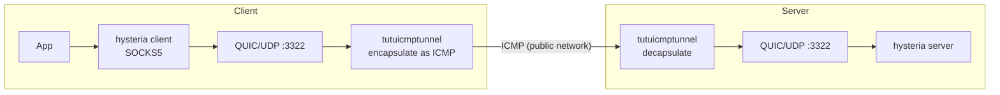

# Protecting hysteria Traffic with tutuicmptunnel

[English](./hysteria.md) | [简体中文](./hysteria_zh-CN.md)

---

`hysteria` uses UDP/QUIC transport, which is susceptible to ISP UDP QoS throttling and interference. With `tutuicmptunnel`, hysteria's UDP traffic can be encapsulated in ICMP packets for transmission:



> [!WARNING]
> All parameters in this document are placeholders (domains, keys, IPs, etc.). Please replace them according to your actual situation. Do not leak real SNI, passwords, IPs or other sensitive information in public spaces.

## Prerequisites

* A working `hysteria` configuration with UDP port `3322`
* `curl` installed on the client:

```bash
# Ubuntu
sudo apt-get install curl

# Arch Linux
sudo pacman -S curl
```

## Deployment

### 1. Assign UID

Choose a unique `UID` for each client device on the server. In this example, the hostname is `a320` and the `UID` is `100`.

Add the following to `/etc/tutuicmptunnel/uids` on the **server**:

```text
100 a320
```

Add the same record to `/etc/tutuicmptunnel/uids` on the **client** as well.

### 2. Modify systemd unit (server side)

> [!IMPORTANT]
> `tutuicmptunnel` cannot handle GSO packets. You must disable hysteria's GSO functionality via the environment variable `QUIC_GO_DISABLE_GSO=1`. This must be set on both client and server.

`/etc/systemd/system/hysteria-server@.service`:

```ini
[Unit]
Description=Hysteria Server (%i.yaml)
After=network.target tutuicmptunnel.service

[Service]
Type=simple
ExecStart=/usr/local/bin/hysteria server --config /etc/hysteria/%i.yaml
DynamicUser=yes
Environment=HYSTERIA_LOG_LEVEL=info QUIC_GO_DISABLE_GSO=1
CapabilityBoundingSet=CAP_NET_ADMIN CAP_NET_BIND_SERVICE CAP_NET_RAW
AmbientCapabilities=CAP_NET_ADMIN CAP_NET_BIND_SERVICE CAP_NET_RAW
NoNewPrivileges=true
Restart=on-failure

[Install]
WantedBy=multi-user.target
```

### 3. Configure client IP sync script

The client can use `tuctl_client` to remotely update the server's `tuctl` configuration. This way, when the client's public IP changes, the server can be notified promptly.

Create `/usr/local/bin/tutuicmptunnel_sync.sh`:

```bash
#!/bin/bash

# This script runs on the client, notifying the server of client config updates via tuctl_client.

V() {
  echo "$@"
  "$@"
}

TMP=$(mktemp)
export DEV=eth0 # Your client's internet interface name
sudo tuctl dump > $TMP
sudo tuctl unload iface $DEV
sudo tuctl load iface $DEV

export TUTU_UID=100 # Replace with the uid or username chosen on your server
export ADDRESS=yourdomain.com # Replace with your hysteria server domain or IP
export PORT=3322 # Replace with your hysteria server udp port

sudo tuctl script - < $TMP
sudo tuctl client
sudo tuctl client-del address $ADDRESS user $TUTU_UID
sudo tuctl client-add address $ADDRESS port $PORT user $TUTU_UID

export COMMENT=yourdevice # Replace with a comment for your client; this will appear in the server's tuctl command output
export HOST=$ADDRESS
export PSK=yourlongpsk # Replace with your tuctl_server PSK password
export SERVER_PORT=your_tuserver_port # Replace with your tuctl_server port

echo "server-add uid $TUTU_UID address @client_ip@ port $PORT comment $COMMENT" | V tuctl_client \
  psk $PSK \
  server $HOST \
  server-port $SERVER_PORT

# vim: set sw=2 ts=2 expandtab:
```

### 4. Start

```bash
# First sync the client IP to the server
/usr/local/bin/tutuicmptunnel_sync.sh

# Then start the hysteria client (GSO must also be disabled)
QUIC_GO_DISABLE_GSO=1 hysteria client -c client.yaml
```

### 5. (Optional) Periodic client IP sync

If the client's public IP changes frequently, you need to periodically update the server. You can use `crontab` to run the sync script every 5 minutes:

```cron
PATH=/usr/local/sbin:/usr/local/bin:/usr/bin:/usr/sbin:/bin:/sbin
*/5 * * * * /usr/local/bin/tutuicmptunnel_sync.sh
```

You can also use `systemd` timer to achieve the same effect:

`/etc/systemd/system/tutuicmptunnel_sync.service`:

```ini
[Unit]
Description=Sync tutuicmptunnel config

[Service]
Type=oneshot
Environment=PATH=/usr/local/sbin:/usr/local/bin:/usr/bin:/usr/sbin:/bin:/sbin
ExecStart=/usr/local/bin/tutuicmptunnel_sync.sh
```

`/etc/systemd/system/tutuicmptunnel_sync.timer`:

```ini
[Unit]
Description=Run tutuicmptunnel_sync every 5 minutes

[Timer]
OnBootSec=5min
OnUnitActiveSec=5min
Persistent=true

[Install]
WantedBy=timers.target
```

> [!NOTE]
> Don't forget to run `systemctl daemon-reload` and enable the timer: `systemctl enable --now tutuicmptunnel_sync.timer`.

## Verification & Testing

**Speed test:**

```bash
hysteria speedtest -c client.yaml
```

**View ICMP tunnel counters:**

```bash
sudo tuctl -d
```

**BPF logs:**

```bash
sudo bpftool prog tracelog
```

**Packet capture to confirm ICMP traffic:**

```bash
sudo tcpdump -i any icmp -n -v
```
