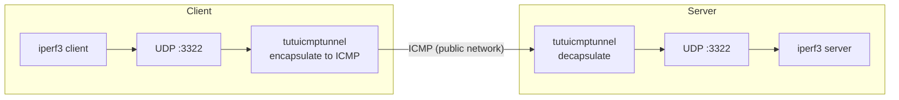

# iperf3

[English](./iperf3.md) | [简体中文](./iperf3_zh-CN.md)

---

The following example demonstrates how to set up a **UDP-over-ICMP tunnel** using `tuctl` and perform throughput testing with `iperf3`.



## Prerequisites

* Both client and server have `tutuicmptunnel` installed and BPF programs can be loaded normally
* Server has SSH key-based authentication configured (deployment script needs to execute commands on the server via `ssh`)
* Both ends have `iperf3` installed

The example parameters used in this article are as follows, replace with your actual environment:

| Parameter | Example Value | Description |
| :--- | :--- | :--- |
| Server hostname | `a320` | SSH key-based auth configured |
| Tunnel UDP port | `3322` | iperf3 listening and test port |
| Tunnel UID | `99` | Registered in `uids` files on both ends |
| Server NIC | `enp4s0` | Server outbound interface |
| Client NIC | `wlan0` | Client outbound interface |

## Deploy Tunnel

Save the following script to the client, name it `run_tunnel.sh`:

```bash
#!/bin/sh
set -e

HOST=a320                    # Server hostname or IP
PORT=3322                    # Tunnel UDP port
HOST_DEV=enp4s0              # Server outbound interface name

UID=99
LOCAL=192.168.15.238         # Client's own address
LOCAL_DEV=wlan0              # Client outbound interface name
COMMENT=r7735h               # Comment, optional

# -------- Server Side --------
ssh $HOST sudo tuctl unload iface $HOST_DEV
ssh $HOST sudo tuctl load   iface $HOST_DEV
ssh $HOST sudo tuctl server
ssh $HOST sudo tuctl server-add uid $UID address $LOCAL port $PORT comment $COMMENT

# -------- Client Side --------
cat << EOF | sudo tuctl script -
unload iface $LOCAL_DEV
load   iface $LOCAL_DEV ethhdr
client
client-add uid $UID address $HOST port $PORT
EOF
```

Execute:

```bash
chmod +x run_tunnel.sh
./run_tunnel.sh
```

The script loads BPF programs on both ends and writes tunnel rules: the server adds rules pointing to the client, and the client adds rules pointing to the server.

## Speed Test

**Start iperf3 server on the server side:**

```bash
ssh a320 "iperf3 -s -p 3322"
```

**Initiate downstream UDP test from client side** (duration 1 hour, packet length 1472 B, target bandwidth 1 Gbps):

```bash
iperf3 -c a320 -p 3322 -u -b 1000m -t 3600 -l 1472 -R
```

> [!NOTE]
> `-R` means reverse (downstream) test, i.e., server sends, client receives. Remove `-R` for upstream test.

**Observe results:**

* The `iperf3` client/server output shows the tunnel's measured bandwidth, packet loss rate, jitter
* Open another terminal on both ends and run `sudo tuctl status debug` to view tunnel processing / drop / GSO counters
* `sudo cat /sys/kernel/tracing/trace_pipe` (or `bpftool prog tracelog`) shows `bpf_printk` logs (if `debug` version is loaded)

## Cleanup

```bash
# Client
sudo tuctl unload iface $LOCAL_DEV

# Server
ssh a320 sudo tuctl unload iface $HOST_DEV
```

This completes an `iperf3` throughput test based on the ICMP tunnel.
