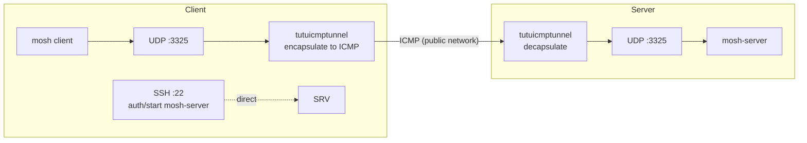

# tutuicmptunnel + MOSH (Pin UDP Port 3325)

[English](./mosh.md) | [简体中文](./mosh_zh-CN.md)

---

This document shows how to **pin MOSH's UDP session port** to a single port (e.g. `3325/udp`), and use **tutuicmptunnel** to encapsulate that UDP traffic into **ICMP echo request/reply**, so you can still use mosh when UDP is blocked or unstable.



## Background

1. **MOSH is not pure SSH**
   mosh starts with **SSH** (for authentication and starting the server-side process), then the actual interactive traffic goes over **UDP**.

2. **The server must run a `mosh-server` process**
   The mosh client runs `mosh-server new ...` on the remote host via SSH, starting a UDP session endpoint.

3. **Pinning the port makes tunneling easy**
   By default, mosh picks a port from a range (commonly 60000–61000).
   For ICMP tunneling, using a single port (or a small range) is more stable and simplifies rules.

---

## Prerequisites

| Parameter | Example Value | Description |
| :--- | :--- | :--- |
| Server address | `test.server` | mosh server domain or IP |
| mosh UDP port | `3325` | Fixed session port |
| tuctl_server port | `14801` | Remote management port |
| tuctl_server PSK | `yourlongpsk` | Remote management passphrase |
| Client UID | `199` | Unique UID assigned on server for this client |

> [!NOTE]
> All values above are examples—replace with your actual configuration. The server must have `tutuicmptunnel-tuctl-server` installed and running, and both server and client must have the UID registered in `/etc/tutuicmptunnel/uids` (see [wireguard tutorial](/docs/wireguard.md) "Assign UID" section).

## Server Configuration

1. Install mosh:

```bash
# Debian/Ubuntu
sudo apt update && sudo apt install -y mosh
```

2. Allow UDP 3325 (if you have a firewall):

```bash
sudo ufw allow 3325/udp
```

## Client Configuration

Save as `mosh-over-icmp.sh`:

```bash
#!/usr/bin/env bash
set -euo pipefail

ADDRESS="test.server"
PORT="3325"
TUTU_UID="199"
SERVER_PORT="14801"
COMMENT="a320-mosh"
PSK="yourlongpsk"

# Adjust to match your server settings
#export TUTUICMPTUNNEL_PWHASH_MEMLIMIT="1048576"

MOSH_USER="${MOSH_USER:-$USER}"
SSH_PORT="${SSH_PORT:-22}"

sudo tuctl unload iface "$(ip route get 1 | awk '{print $5; exit}')"
sudo tuctl load iface "$(ip route get 1 | awk '{print $5; exit}')"
sudo tuctl client
sudo tuctl client-del uid "$TUTU_UID" address "$ADDRESS"
sudo tuctl client-add uid "$TUTU_UID" address "$ADDRESS" port "$PORT"
sudo tuctl status

tuctl_client psk "$PSK" server "$ADDRESS" server-port "$SERVER_PORT" \
  <<< "server-add uid $TUTU_UID address @client_ip@ port $PORT comment $COMMENT"

if [[ "$SSH_PORT" == "22" ]]; then
  exec mosh --server="mosh-server new -p ${PORT}:${PORT}" \
    "${MOSH_USER}@${ADDRESS}"
else
  exec mosh --ssh="ssh -p ${SSH_PORT}" \
    --server="mosh-server new -p ${PORT}:${PORT}" \
    "${MOSH_USER}@${ADDRESS}"
fi
```

The script does three things: registers client rules locally via `tuctl`, remotely notifies the server to add rules via `tuctl_client`, then starts mosh with the fixed port.

## Start

```bash
chmod +x mosh-over-icmp.sh
./mosh-over-icmp.sh
```

Specify login username or custom SSH port:

```bash
MOSH_USER=root SSH_PORT=2222 ./mosh-over-icmp.sh
```

## Verification

**Check UDP listener on server:**

```bash
sudo ss -lunp | grep ':3325'
```

**Capture ICMP on client to confirm traffic is encapsulated:**

```bash
sudo tcpdump -ni any icmp
```

> [!TIP]
> If mosh connection drops immediately after establishing, first check that the UID in `uids` files matches on both ends, and that the server firewall allows the corresponding port.
