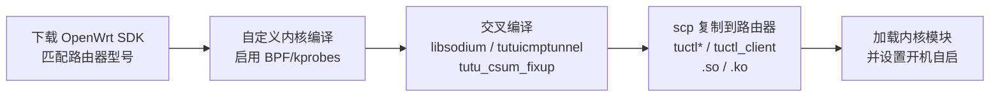

# OpenWrt 客户端指南

[English](./openwrt.md) | [简体中文](./openwrt_zh-CN.md)

---

## 概述

`tutuicmptunnel` 依赖 `eBPF` 和 `kprobes` 等高级内核特性，无法直接在标准的 OpenWrt 固件上运行。
标准的 OpenWrt 内核为了保持精简，默认裁剪了这些对于普通路由功能非必需的调试和追踪功能。

本指南将详细介绍如何交叉编译 `tutuicmptunnel` 项目，使其在 `OpenWrt` 设备上成功运行客户端模式。

整体流程如下：



### 环境准备

下载与你的路由器型号对应的 OpenWrt SDK。以小米 AX3000T 为例，在[固件下载页面](https://downloads.openwrt.org/releases/24.10.5/targets/mediatek/filogic/)下方找到：

* [openwrt-sdk-24.10.5-mediatek-filogic_gcc-13.3.0_musl.Linux-x86_64.tar.zst](https://downloads.openwrt.org/releases/24.10.5/targets/mediatek/filogic/openwrt-sdk-24.10.5-mediatek-filogic_gcc-13.3.0_musl.Linux-x86_64.tar.zst)

下载后解压到 `$HOME/temp` 目录。

### 内核配置

由于 OpenWrt 做了一定裁剪，需要重新编译 OpenWrt 内核形成新的固件包。在 OpenWrt `menuconfig` 中添加或修改以下选项：

* `CONFIG_KERNEL_KPROBES=y`
* `CONFIG_KERNEL_KALLSYMS=y`
* `CONFIG_KERNEL_DEBUG_INFO=y`
* `CONFIG_KERNEL_DEBUG_INFO_BTF=y`（需要关闭 `CONFIG_KERNEL_DEBUG_INFO_REDUCED`）
* `CONFIG_PACKAGE_kmod-sched-core=m`
* `CONFIG_PACKAGE_kmod-sched-bpf=m`

为了方便起见，建议编译所有 OpenWrt 设备用过的 `kmod`，或者添加选项：`CONFIG_ALL_KMOD=y`。

### 用户态工具

需要编译以下包用于查看 `bpf` 规则和检视 `bpf` 状态，它会自动依赖 `libbpf` 从而能让 `tuctl` 正常编译：

* `CONFIG_PACKAGE_tc-bpf`
* `CONFIG_PACKAGE_bpftool-full`

### 1. 设置编译环境

```bash
export STAGING_DIR=${HOME}/temp/openwrt-sdk-24.10.5-mediatek-filogic_gcc-13.3.0_musl.Linux-x86_64/staging_dir
export TOOLCHAIN_GLOB=$STAGING_DIR/toolchain-*
export TARGETROOT_GLOB=$STAGING_DIR/target-*
export TOOLCHAIN=( $TOOLCHAIN_GLOB )
export TARGETROOT=( $TARGETROOT_GLOB )
export KERNEL_DIR_GLOB=$STAGING_DIR/../build_dir/target-*/linux-*/linux-*
export KERNEL_DIR=( $KERNEL_DIR_GLOB )
export ARCH=aarch64
export CC=${TOOLCHAIN}/bin/$ARCH-openwrt-linux-gcc
export LIBSODIUM_TAG=1.0.20-RELEASE
export KERNEL_ARCH=arm64

echo ================================================================================
echo "TOOLCHAIN:  ${TOOLCHAIN}"
echo "TARGETROOT: ${TARGETROOT}"
echo "KERNEL_DIR:  ${KERNEL_DIR}"
echo "CC:  ${CC}"
echo ================================================================================
```

确认输出的 `TOOLCHAIN`、`TARGETROOT`、`KERNEL_DIR` 路径均有效后再继续。

### 2. 编译依赖库

```bash
# 编译 libsodium
git clone https://github.com/jedisct1/libsodium.git
cd libsodium
git checkout $LIBSODIUM_TAG # 选择一个最新的稳定版发布
./autogen.sh
./configure --host=$ARCH-openwrt-linux \
  CC=${TOOLCHAIN}/bin/$ARCH-openwrt-linux-gcc
make -j $(nproc)

# 编译 libbpf
cd ..
git clone https://github.com/libbpf/libbpf.git
cd libbpf
git submodule update --init
cd src
make OBJDIR=${HOME}/temp/libbpf-build DESTDIR=${HOME}/temp/libbpf-install \
  INCLUDEDIR=/usr/lib/include LIBDIR=/usr/lib \
  install
```

### 3. 编译 tutuicmptunnel

```bash
cd ../..
git clone https://github.com/hrimfaxi/tutuicmptunnel.git
cd tutuicmptunnel
rm -f CMakeCache.txt

export STAGING_DIR_HOST="$STAGING_DIR/host"
export PKG_CONFIG_LIBDIR="$TARGETROOT/usr/lib/pkgconfig"
export PKG_CONFIG="$STAGING_DIR_HOST/bin/pkg-config"
export PATH="$STAGING_DIR_HOST/bin:$PATH"

cmake \
  -DCMAKE_TOOLCHAIN_FILE=$(pwd)/toolchains/openwrt-$ARCH.cmake \
  -DBISON_EXECUTABLE=/usr/bin/bison \
  -DCMAKE_BUILD_TYPE=Release \
  -DENABLE_HARDEN_MODE=ON \
  -DUSE_SYSTEM_LIBBPF_BPFTOOL=0 \
  -DSODIUM_INCLUDE_DIR=$(pwd)/../libsodium/src/libsodium/include -DSODIUM_LIBRARY=$(pwd)/../libsodium/src/libsodium/.libs/libsodium.so \
  .
make VERBOSE=1 clean all
make install DESTDIR=stripped
```

## 部署到设备

将编译产物复制到 OpenWrt 设备：

```bash
scp stripped/usr/local/bin/tuctl* router:/usr/bin/
scp stripped/usr/local/sbin/tuctl router:/usr/sbin/
scp ../libsodium/src/libsodium/.libs/libsodium.so router:/usr/lib/
```

此时即可在 OpenWrt 设备上使用 `tuctl`、`tuctl_client` 等程序。

## 降低 tuctl_client 内存占用

路由器等内存受限设备上，可以通过环境变量 `TUTUICMPTUNNEL_PWHASH_MEMLIMIT`（单位：字节）降低密码哈希的内存占用。

**服务端**（systemd 单元文件）：

```ini
Environment=TUTUICMPTUNNEL_PWHASH_MEMLIMIT=1048576
```

**客户端**：

```bash
TUTUICMPTUNNEL_PWHASH_MEMLIMIT=1048576 tuctl_client ...
```

> [!WARNING]
> * 服务端与客户端必须使用**相同的数值**，否则握手失败、无法建立通信。
> * 数值越小内存占用越低，但安全性也随之下降，请根据设备能力和风险评估自行权衡。
