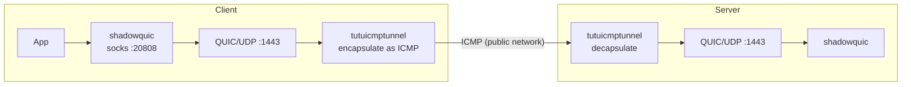

# Protecting shadowquic Traffic with tutuicmptunnel

[English](./shadowquic.md) | [简体中文](./shadowquic_zh-CN.md)

---

`shadowquic` is a proxy tool built on **Rust** and **quinn (QUIC)**. Its design philosophy is similar to Hysteria: using **UDP/QUIC** transport for higher throughput and better performance on unstable networks. Combined with `tutuicmptunnel`, QUIC UDP traffic can be encapsulated in ICMP packets for transmission, bypassing UDP QoS throttling and interference.

> [!IMPORTANT]
> Please use shadowquic **v0.3.3 or newer**. Older versions do not support disabling **GSO** and cannot work properly with `tutuicmptunnel`.



## Features & Benefits

1. **Fast, with lower resource usage**

   In my test environment (mipsle, Xiaomi R3G router), `shadowquic` uses about **1/3** the memory of `hysteria`, and under high load its CPU usage is only about **50%**.

2. **JLS (certificate-free deployment)**

   `shadowquic` uses JLS — a TLS 1.3-style handshake obfuscation and authentication scheme that relies on shared credentials rather than traditional certificate systems. This means you don't need ACME-issued certificates or a self-managed certificate chain like you typically do with `hysteria`.

   * The client-side `server-name` is used for handshake appearance/fingerprint alignment
   * It generally needs to match the server's `jls_upstream`

3. **Rust memory safety**

   Rust eliminates common memory safety issues found in traditional C/C++ at the language level.

## Installation & Configuration

### Server

Install and start the service:

```bash
curl -L https://raw.githubusercontent.com/spongebob888/shadowquic/main/scripts/linux_install.sh | bash
systemctl daemon-reload
systemctl enable --now shadowquic.service
```

#### Disable GSO (required)

To work with `tutuicmptunnel`, edit `/etc/shadowquic/server.yaml` and add (or ensure) the following under `inbound`:

```yaml
inbound:
  ...
  gso: false
```

Then restart the service:

```bash
systemctl restart shadowquic.service
```

### Client

Fill in the username/password generated by the server script into `client.yaml`, and also **disable GSO**:

```yaml
inbound:
  type: socks
  bind-addr: "127.0.0.1:20808"

outbound:
  type: shadowquic
  addr: "1.2.3.4:1443"
  username: "username"           # Username
  password: "password"           # Password
  server-name: "cloudflare.com"  # Usually should match server jls_upstream (fingerprint alignment)
  alpn: ["h3"]
  initial-mtu: 1000
  congestion-control: bbr
  zero-rtt: true
  gso: false                     # for tutuicmptunnel, must be disabled
  over-stream: false             # true: UDP over stream; false: UDP over datagram

log-level: "info"
```

Start the client:

```bash
shadowquic -c client.yaml
```

## Connecting to tutuicmptunnel

Once the client is running, you can use `tutuicmptunnel` to encapsulate and protect the traffic. The configuration method is basically the same as the [hysteria tutorial](/docs/hysteria.md) — just change the port to `1443`.
