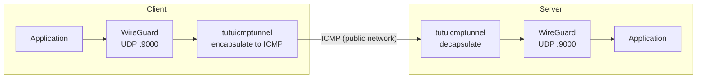

# WireGuard

[English](./wireguard.md) | [简体中文](./wireguard_zh-CN.md)

---

`WireGuard` is an efficient and powerful `UDP`-based `VPN` protocol. To prevent traffic from being QoS throttled or interfered with by `ISP`s targeting `UDP`, `tutuicmptunnel` can be used to encapsulate and protect `WireGuard` traffic.



## Prerequisites

This tutorial assumes you already have a configured `/etc/wireguard/myserver.conf`, and will now adjust it to enable `tutuicmptunnel` encapsulation.

The known parameters are as follows:

| Parameter | Value |
| :--- | :--- |
| WireGuard Server Port | `9000` |
| Server Domain | `myserver.ip` |
| tuctl_server Port | `9010` |
| tuctl_server PSK Password | `verylongpsk` |

> [!NOTE]
> Please replace the above parameters with your actual values. The server must have `tutuicmptunnel-tuctl-server` installed and running, so the client can remotely manage server rules via `tuctl_client`.

## Deployment

### 1. Assign UID

Choose a unique `uid` and hostname for your client device. In our example, `uid = 100`, hostname `a320`.

Add the following to `/etc/tutuicmptunnel/uids` on **both the server and client**:

```text
100 a320
```

### 2. Create environment variable file

> [!IMPORTANT]
> The following operations are performed on the **client**.

Create `/etc/wireguard/tutuicmptunnel.myserver`:

```sh
#!/bin/sh

TUTU_UID=a320
ADDR=myserver.ip
PORT=9000
SERVER_PORT=9010
PSK=verylongpsk
COMMENT=myserver-wgserver
```

### 3. Configure WireGuard hooks

Add the following hooks to the `[Interface]` section in `/etc/wireguard/myserver.conf` to automatically manage rules when the interface starts and stops:

```ini
[Interface]
# Before interface starts: add local client rules
PreUp = env_file=$(dirname $CONFIG_FILE)/tutuicmptunnel.myserver; source $env_file && tuctl client-add user $TUTU_UID address $ADDR port $PORT comment $COMMENT || true
# Before interface starts: remotely add server rules via tuctl_client
PreUp = env_file=$(dirname $CONFIG_FILE)/tutuicmptunnel.myserver; source $env_file && tuctl_client server $ADDR server-port $SERVER_PORT psk $PSK <<< "server-add user $TUTU_UID comment $COMMENT address @client_ip@ port $PORT" || true
# After interface shuts down: delete local client rules
PostDown = env_file=$(dirname $CONFIG_FILE)/tutuicmptunnel.myserver; source $env_file && tuctl client-del user $TUTU_UID address $ADDR || true
# After interface shuts down: remotely delete server rules
PostDown = env_file=$(dirname $CONFIG_FILE)/tutuicmptunnel.myserver; source $env_file && tuctl_client server $ADDR server-port $SERVER_PORT psk $PSK <<< "server-del user $TUTU_UID" || true
```

With this configuration, every time the `WireGuard` `myserver` interface is started, client and server rules will be automatically added; when the interface is closed, relevant rules will be automatically deleted.

### 4. Restart interface

Use `wg-quick` to restart the interface:

```bash
sudo wg-quick down myserver
sudo wg-quick up myserver
```

## Troubleshooting

To troubleshoot `ICMP` traffic, use the following command:

```bash
sudo tcpdump -i any -n icmp -v
```

> [!TIP]
> Enabling the `tcp_bbr` congestion control algorithm can significantly improve `WireGuard` performance.
