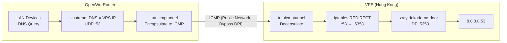

# Protecting DNS Queries with tutuicmptunnel (xray + OpenWrt)

[English](./xray_dns.md) | [简体中文](./xray_dns_zh-CN.md)

---

Forward DNS queries on a VPS to `8.8.8.8` via **xray-core** `dokodemo-door`, and on the OpenWrt side use **tutuicmptunnel** to encapsulate UDP DNS queries into ICMP, reducing the chance of DPI interference and DNS poisoning. Use **iptables** to redirect inbound `53/UDP` to local `5353/UDP` to avoid conflicts with `systemd-resolved` occupying port 53.



## Overall Approach

* Choose a Hong Kong VPS (EDNS routing is closer to mainland China, resulting in lower latency).
* On the VPS, run xray-core with a `dokodemo-door` inbound on `5353/UDP`, forwarding to `8.8.8.8:53`.
* On the VPS, use iptables to redirect `53/UDP` on `eth0` to `5353/UDP`.
* On OpenWrt, use `tutuicmptunnel` to encapsulate outbound DNS UDP traffic into ICMP and forward it, bypassing GFW DPI.
* Use a hotplug script to automatically create/remove the tunnel when the OpenWrt WAN interface goes up/down.
* Finally, configure the upstream DNS on OpenWrt to your VPS IP.

## VPS-Side Configuration

### 1. Configure xray-core

Add an inbound (`dokodemo-door`) on the server listening on `5353/UDP` and forwarding to `8.8.8.8:53`:

```json
{
  "port": 5353,
  "protocol": "dokodemo-door",
  "settings": {
    "address": "8.8.8.8",
    "port": 53,
    "network": "udp"
  },
  "tag": "dns-in"
}
```

> [!NOTE]
> * Port `5353` is used to avoid conflict with `systemd-resolved`, which occupies port `53`.
> * This inbound handles **UDP only**.

Restart the service:

```sh
sudo systemctl restart xray
```

### 2. Port Redirection (iptables)

> [!WARNING]
> This configuration makes the VPS's public `53/UDP` act as an **open DNS recursive resolver** when the tunnel is not established — anyone can `dig @your_vps_ip` and get an answer. Many VPS providers explicitly prohibit open port 53 (to prevent DNS amplification abuse) and may trigger abuse warnings or even suspend your server. If your provider has this restriction, or you prefer a safer approach, use the "[Alternative: Use non-standard port directly](#alternative-use-non-standard-port-directly)" method below.

Redirect UDP/53 arriving on `eth0` to local UDP/5353. Insert the rule at the top to avoid being preempted by other rules:

```sh
sudo iptables -t nat -I PREROUTING 1 -i eth0 -p udp --dport 53 -j REDIRECT --to-ports 5353
```

Persist rules (Debian/Ubuntu):

```sh
sudo apt-get install -y iptables-persistent
sudo netfilter-persistent save
```

Verify:

```sh
sudo iptables -t nat -L -v -n
```

### 3. Verify Resolution (and Current Pollution Status)

Test DNS resolution from an external machine:

```sh
dig reddit.com @your_vps_ip
```

```text
;; ->>HEADER<<- opcode: QUERY, rcode: NOERROR, id: 44623
;; flags: qr rd ra ; QUERY: 1, ANSWER: 4, AUTHORITY: 0, ADDITIONAL: 0
;; QUESTION SECTION:
;; reddit.com.    IN    A

;; ANSWER SECTION:
reddit.com.    192    IN    A    151.101.193.140
reddit.com.    192    IN    A    151.101.1.140
reddit.com.    192    IN    A    151.101.65.140
reddit.com.    192    IN    A    151.101.129.140

;; Query time: 80 msec
;; MSG SIZE  rcvd: 92
```

But don't celebrate too early — at this point the query still goes over plaintext UDP, and GFW DPI can still poison your results:

```sh
dig www.google.com @your_vps_ip
```

```text
;; ->>HEADER<<- opcode: QUERY, rcode: NOERROR, id: 62391
;; flags: qr rd ra ; QUERY: 1, ANSWER: 1, AUTHORITY: 0, ADDITIONAL: 0
;; QUESTION SECTION:
;; www.google.com.    IN    A

;; ANSWER SECTION:
www.google.com.    141    IN    A    31.13.88.26

;; Query time: 51 msec
;; MSG SIZE  rcvd: 48
```

The returned `31.13.88.26` is a poisoned result. Next, use tutuicmptunnel to fix this.

### Alternative: Use Non-Standard Port Directly

A safer approach is to **never expose port 53 on the public network at all**: have xray listen directly on a non-standard port (e.g. 5353), and have the client tunnel forward directly to that port, eliminating the iptables REDIRECT step entirely:

1. xray config unchanged (dokodemo-door listening on 5353/UDP)
2. **Skip** the iptables REDIRECT configuration above
3. Change `PORT` in the OpenWrt hotplug scripts to `5353`
4. Configure OpenWrt upstream DNS as `VPS_IP#5353` (dnsmasq supports `server=x.x.x.x#5353` syntax)

Since tutuicmptunnel encapsulates the traffic as ICMP packets on the public network, the UDP port is never externally visible — this approach eliminates the open resolver exposure entirely.

## OpenWrt-Side Configuration

### 1. Register UID

Add the corresponding UID on both server and client in `/etc/tutuicmptunnel/uids`, for example:

```text
116 yourname-dns
```

### 2. Configure Hotplug Scripts

Use hotplug to create the tunnel on WAN up and clean it up on WAN down. Replace the variables with your real values (`HOST`, `PSK`, `UID_`, etc.).

`/etc/hotplug.d/iface/95-wan-up`:

```bash
#!/bin/sh

[ "$ACTION" = "ifup" ] || exit 0
[ "$INTERFACE" = "wan" ] || exit 0

logger "Starting custom WAN script"

UID_=yourname-dns
HOST=x.x.x.x
PSK=yourpsk
PORT=53
#export TUTUICMPTUNNEL_PWHASH_MEMLIMIT=1048576 # adjust according to your tuserver settings

V() {
  echo "$@"
  "$@"
}

tuctl client-del $UID_ address $HOST
tuctl client-add uid $UID_ address $HOST port $PORT comment your-vps-name-dns
echo "server-add uid $UID_ address @client_ip@ port $PORT comment yourname-dns" | V tuctl_client server $HOST server-port 14801 psk $PSK
```

`/etc/hotplug.d/iface/95-wan-down`:

```bash
#!/bin/sh

[ "$ACTION" = "ifdown" ] || exit 0
[ "$INTERFACE" = "wan" ] || exit 0

logger "Stopping custom WAN script"

UID_=yourname-dns
HOST=x.x.x.x
PSK=yourpsk
PORT=53
COMMENT=yourname-dns
#export TUTUICMPTUNNEL_PWHASH_MEMLIMIT=1048576 # adjust according to your tuserver settings

V() {
  echo "$@"
  "$@"
}

tuctl client-del uid $UID_ address $HOST
echo "server-del uid $UID_" | V tuctl_client server $HOST server-port 14801 psk $PSK
```

> [!NOTE]
> * `UID_` identifies this tunnel instance and must match on both sides.
> * `HOST` is your VPS public IP.
> * `PSK` is the pre-shared key.
> * Keep the `tuctl_client`/`tuctl` commands and the management port `14801` consistent with your deployment.
> * `tutuicmptunnel` performs UDP→ICMP conversion **before** netfilter, so it won't conflict with iptables `REDIRECT`.
> * Ensure OpenWrt and the VPS have synchronized time to avoid failures in key/session-based mechanisms.

### 3. Enable Tunnel

Restart the WAN interface to trigger the hotplug scripts:

```bash
ifdown wan; ifup wan
```

## Verification

Test resolution again:

```sh
dig reddit.com @your_vps_ip
```

```text
;; ->>HEADER<<- opcode: QUERY, rcode: NOERROR, id: 44623
;; flags: qr rd ra ; QUERY: 1, ANSWER: 4, AUTHORITY: 0, ADDITIONAL: 0
;; ANSWER SECTION:
reddit.com.    192    IN    A    151.101.193.140
reddit.com.    192    IN    A    151.101.1.140
reddit.com.    192    IN    A    151.101.65.140
reddit.com.    192    IN    A    151.101.129.140

;; Query time: 80 msec
;; MSG SIZE  rcvd: 92
```

If you get four consistent IPs that match global public resolution, poisoning is significantly mitigated. Then set the primary DNS in the network interface or DHCP/DNS settings to your VPS IP (`HOST`).

## Summary

- **xray-core** forwards DNS queries arriving at the VPS on `53/UDP` to a robust public DNS resolver.
- **iptables** redirects external `53/UDP` traffic to xray's `5353/UDP` listener to avoid port conflicts.
- **tutuicmptunnel** converts DNS UDP queries into ICMP on OpenWrt, effectively reducing DPI-based poisoning.
- **Hotplug scripts** manage the tunnel automatically, yielding a stable workflow and improved DNS correctness.

> [!WARNING]
> With the iptables REDIRECT approach, the VPS's public port 53 is an open resolver — some VPS providers prohibit open port 53. If concerned, use the "Alternative: Use non-standard port directly" method.
