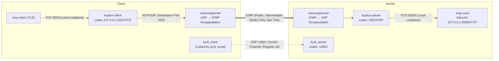

# Xray + KCPTun + tutuicmptunnel

[English](./xray_kcptun.md) | [简体中文](./xray_kcptun_zh-CN.md)

---

## Overview

`xray-core` is a commonly used network proxy tool. To improve transmission performance and anti-interference capability, you can layer `kcptun` on top:

1. On the server side, use the `xray-core` inbound listening address (usually TCP port) as the `kcptun-server`'s target, with `kcptun-server` listening on UDP port externally;
2. On the client side, run `kcptun-client` to convert local TCP traffic (like TLS) to KCP protocol (based on UDP) and send to server.

At this point, intermediate nodes see KCP (UDP) traffic, which sometimes gets targeted QoS throttling from ISPs. To address this, you can layer `tutuicmptunnel` on both ends to further encapsulate UDP traffic and convert it to ICMP traffic. This way, intermediate nodes only see ICMP packets, further improving traffic stealth and penetration capability.

The overall link is as follows:



- **Data Plane** (solid lines): `xray`'s TLS traffic → local `kcptun-client` → encapsulated as ICMP traversing public network → server decapsulation → `kcptun-server` → back to local `xray-core`.
- **Control Plane** (dashed lines): `tuctl_client` in `tutuicmptunnel_sync.sh` only registers uid and port with server's `tuctl_server` (14801), business traffic itself doesn't pass through it.

## Prerequisites

This document assumes:

- You already have a working `xray-core` server and client configuration, server listening on TCP 20000 port (TLS);
- Both server and client have the latest `kcptun` installed, executables located in `/usr/local/bin` directory. This document uses `kcptun-server` / `kcptun-client` as binary file names, please ensure they match the actual installed file names (use `ls /usr/local/bin/` to confirm).

The ports involved in this article:

| Port | Protocol | Location | Purpose |
| ----- | ---- | ------ | -------------------------- |
| 20000 | TCP | Server | `xray-core` inbound (TLS) |
| 3322 | UDP | Server | `kcptun-server` listening port |
| 3323 | TCP | Client | `kcptun-client` local listening |
| 14801 | UDP | Server | `tuctl_server` listening port |

The configuration is done in two steps:

1. Use `kcptun` to convert traffic from TCP to UDP (KCP) on the communication path;
2. Use `tutuicmptunnel` to further encapsulate UDP traffic as ICMP for final penetration and camouflage.

## Configure kcptun-server (Server)

Create the environment variable file `/etc/default/kcptun-server`:

```bash
# SMUX version, usually keep at 2
KCPTUN_SMUXVER=2
# Encryption key, recommended to generate randomly using the method below
KCPTUN_KEY=LC2N0lx5_Kq6l.6l
# Target: xray-core's inbound address
KCPTUN_TARGET=127.0.0.1:20000
# kcptun-server's UDP listening port
KCPTUN_LISTEN=:3322
KCPTUN_MODE=fast
KCPTUN_CRYPT=xor
KCPTUN_SOCKBUF=16777217
# KCP send window size
KCPTUN_SNDWND=4096
# KCP receive window size
KCPTUN_RCVWND=512
KCPTUN_DATASHARD=0
KCPTUN_PARITYSHARD=0
# KCP MTU, max 1444
KCPTUN_MTU=1400
```

Notes:

- Encryption uses `xor` mode, which can slightly mask traffic characteristics;
- Use the following command to generate a 16-byte random key:

```bash
python3 -c "import random, string; print('KCPTUN_KEY=' + ''.join(random.choices(string.ascii_letters + string.digits + '._', k=16)))"
```

- `KCPTUN_KEY` must be consistent between server and client.

> **Tip**: If `KCPTUN_SOCKBUF` exceeds the system default socket buffer limit, increase `net.core.rmem_max` / `net.core.wmem_max` accordingly, otherwise the setting won't take effect.

Create systemd unit file `/etc/systemd/system/kcptun@.service`:

```ini
[Unit]
Description=KCPTun Server
After=network.target

[Service]
Type=simple
EnvironmentFile=/etc/default/kcptun-%i
DynamicUser=yes
AmbientCapabilities=CAP_NET_BIND_SERVICE
ProtectSystem=full
ProtectHome=yes
NoNewPrivileges=true
PrivateTmp=yes
ProtectHostname=yes
ProtectClock=yes
ProtectKernelModules=yes
ProtectKernelTunables=yes
ProtectControlGroups=yes
RestrictSUIDSGID=yes
RestrictRealtime=yes
RestrictNamespaces=yes
LockPersonality=yes
LimitNOFILE=1048576

ExecStart=/usr/local/bin/kcptun-server \
  --smuxver "$KCPTUN_SMUXVER" \
  -t "$KCPTUN_TARGET" -l "$KCPTUN_LISTEN" \
  -mode "$KCPTUN_MODE" -nocomp \
  --datashard "$KCPTUN_DATASHARD" \
  --parityshard "$KCPTUN_PARITYSHARD" \
  --crypt "$KCPTUN_CRYPT" --key "$KCPTUN_KEY" \
  -sockbuf "$KCPTUN_SOCKBUF" \
  --sndwnd "$KCPTUN_SNDWND" --rcvwnd "$KCPTUN_RCVWND" \
  --mtu "$KCPTUN_MTU"

Restart=on-failure
RestartSec=2

[Install]
WantedBy=multi-user.target
```

Start and enable on boot:

```bash
sudo systemctl enable --now kcptun@server
```

## Configure kcptun-client (Client)

Create environment variable file `/etc/default/kcptun-client-yourhostname`:

```bash
# SMUX version, consistent with server
KCPTUN_SMUXVER=2
# Server address
KCPTUN_HOST=yourdomain.com
# Server kcptun UDP port
KCPTUN_PORT=3322
# kcptun-client local listening port (TCP)
KCPTUN_LOCAL_PORT=3323
KCPTUN_MODE=fast
KCPTUN_NOCOMP=-nocomp
# Auto-expire time for a single UDP session (seconds), 0 or negative disables
KCPTUN_AUTOEXPIRE=900
KCPTUN_DATASHARD=0
KCPTUN_PARITYSHARD=0
KCPTUN_CRYPT=xor
# Same key as server
KCPTUN_KEY=LC2N0lx5_Kq6l.6l
KCPTUN_RCVWND=4096
KCPTUN_SNDWND=256
KCPTUN_SOCKBUF=16777217
KCPTUN_MTU=1400
```

Create systemd unit file `/etc/systemd/system/kcptun-client@.service`:

```ini
[Unit]
Description=KCPTun Client
After=network.target

[Service]
Type=simple
# Load environment variables (keys, etc.)
EnvironmentFile=/etc/default/kcptun-client-%i
# Use DynamicUser for isolation
DynamicUser=yes
# Capability needed for listening on low ports; kept here for convenience
AmbientCapabilities=CAP_NET_BIND_SERVICE
# File system and home directory protection
ProtectSystem=full
ProtectHome=yes
# Additional security hardening
NoNewPrivileges=true
PrivateTmp=yes
ProtectHostname=yes
ProtectClock=yes
ProtectKernelModules=yes
ProtectKernelTunables=yes
ProtectControlGroups=yes
RestrictSUIDSGID=yes
RestrictRealtime=yes
RestrictNamespaces=yes
LockPersonality=yes
# Resource limits, adjust as needed
LimitNOFILE=1048576

ExecStart=/usr/local/bin/kcptun-client \
    --smuxver "${KCPTUN_SMUXVER}" \
    -r "${KCPTUN_HOST}:${KCPTUN_PORT}" \
    -l ":${KCPTUN_LOCAL_PORT}" \
    -mode "${KCPTUN_MODE}" \
    ${KCPTUN_NOCOMP} \
    -autoexpire "${KCPTUN_AUTOEXPIRE}" \
    --datashard "${KCPTUN_DATASHARD}" \
    --parityshard "${KCPTUN_PARITYSHARD}" \
    --crypt "${KCPTUN_CRYPT}" \
    --key "${KCPTUN_KEY}" \
    --rcvwnd "${KCPTUN_RCVWND}" \
    --sndwnd "${KCPTUN_SNDWND}" \
    -sockbuf "${KCPTUN_SOCKBUF}" \
    --mtu "${KCPTUN_MTU}"

Restart=on-failure
RestartSec=2

[Install]
WantedBy=multi-user.target
```

Start and enable on boot:

```bash
sudo systemctl enable --now kcptun-client@yourhostname
# Verify process parameters match expectations
ps -ef | grep kcptun
```

## Modify Xray Client Outbound

Copy your existing client config (e.g. `config-kcp.json`), change the outbound server address to `127.0.0.1` and port to `3323` (i.e. `kcptun-client`'s local listening port), leaving other settings unchanged. This way `xray-client`'s TLS traffic first goes to the local `kcptun-client`, which then forwards it to the remote server.

Run `xray-core`:

```bash
xray -c config-kcp.json
```

Use `tcpdump` to verify the outbound traffic has become UDP (KCP):

```bash
sudo tcpdump -i any -n -v udp and port 3322
```

## Configure tutuicmptunnel

Create the sync script `/usr/local/bin/tutuicmptunnel_sync.sh`:

```bash
#!/bin/bash

V() {
  echo "$@"
  "$@"
}

TMP=$(mktemp)
DEV=enp4s0                # Client's uplink interface name

sudo tuctl dump > "$TMP"
sudo tuctl unload iface "$DEV"
sudo tuctl load iface "$DEV"

TUTU_UID=yourdevice       # UID assigned to this client on the server
ADDRESS=yourdomain.com    # xray-core server domain or IP
PORT=3322                 # Server kcptun-server's UDP listening port (i.e. KCPTUN_LISTEN port)

sudo tuctl script - < "$TMP"
sudo tuctl client
sudo tuctl client-add address "$ADDRESS" port "$PORT" user "$TUTU_UID"

COMMENT=yourdevice        # Client comment, visible in server's tuctl output
HOST=$ADDRESS
PSK=yourlongpsk           # tuctl_server PSK
SERVER_PORT=14801          # tuctl_server listening port

echo "server-add uid $TUTU_UID address @client_ip@ port $PORT comment $COMMENT" | V tuctl_client \
  psk "$PSK" \
  server "$HOST" \
  server-port "$SERVER_PORT"

# vim: set sw=2 ts=2 expandtab:
```

Note: `PORT` matches the **destination UDP port on the wire**, i.e. the server's `kcptun-server` listening port. The client-side `3323` only exists on loopback and is TCP — it never appears as UDP on the wire, so it must not be used here.

Run the script. If everything is normal, `kcptun`'s UDP traffic will be encapsulated as ICMP traffic. Observe with:

```bash
# Should see continuous ICMP packets
sudo tcpdump -i any -n -v icmp

# Can also confirm port 3322 UDP traffic has disappeared
sudo tcpdump -i any -n -v udp and port 3322
```

## Enable on Boot

`tutuicmptunnel` configuration needs to be re-applied after BPF programs are loaded. See [hysteria](hysteria.md) for how to use `crontab` or a systemd timer to periodically call `/usr/local/bin/tutuicmptunnel_sync.sh` for auto-start.
